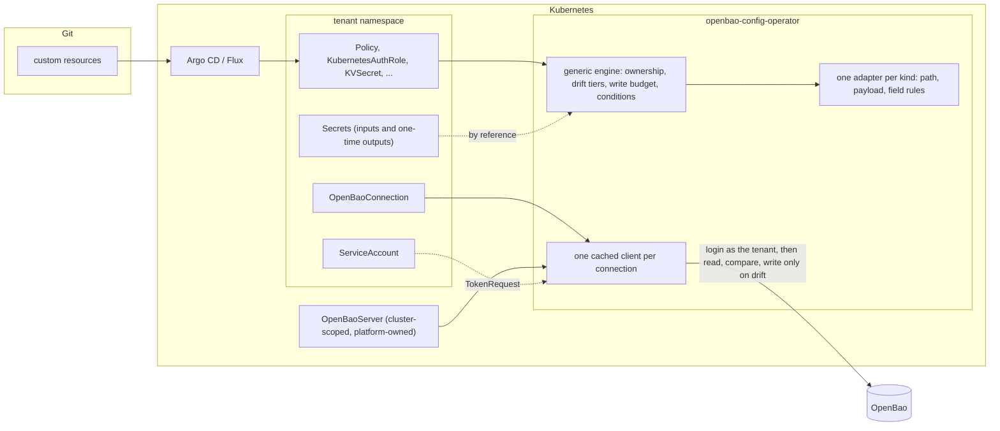

# openbao-config-operator

**A Kubernetes operator that keeps the configuration of an OpenBao server, such as its policies, auth methods and
mounts, the same as the custom resources you keep in Git.**

<!-- Replace the Best Practices badge with https://www.bestpractices.dev/projects/<id>/badge once the project is registered. -->

**[Read the documentation](https://alexandrust88.github.io/openbao-config-operator/)**: [quickstart on kind](https://alexandrust88.github.io/openbao-config-operator/get-started/quickstart/),
[install](https://alexandrust88.github.io/openbao-config-operator/get-started/install/), [guides](https://alexandrust88.github.io/openbao-config-operator/guides/), [API reference](https://alexandrust88.github.io/openbao-config-operator/reference/api/).

openbao-config-operator keeps the configuration of an existing [OpenBao](https://openbao.org) server in the
state that Kubernetes custom resources declare: policies, namespaces, mounts, auth methods and roles, secrets
engines, identity, the OIDC provider and MFA. One custom resource is one object at one OpenBao API path. Commit
YAML to Git, let Argo CD or Flux apply it, and the operator converges OpenBao, reports drift and repairs it.

It does not deploy, initialise, unseal or upgrade OpenBao, and it does not copy secret values into Kubernetes
(use [External Secrets Operator](https://external-secrets.io) for that).

> **Status: alpha.** Each [release](https://github.com/alexandrust88/openbao-config-operator/releases) ships a
> signed image, Helm chart and `install.yaml`. The API is `v1alpha1`;
> the API group domain `openbaoconfig.io` is final ([ADR 0008](docs/adr/0008-provisional-api-group-domain.md)).
> Read the [risks](#risks) and the [known limitations](docs/reference/limitations.md) before you rely on it; the
> [roadmap](docs/maintainers/roadmap.md) says what comes next.

## Today and its limits

Platform teams that run OpenBao for many tenants want its configuration in Git, reviewed and reconciled like
everything else in the cluster. Several tools already manage this configuration declaratively. They differ
in model more than in quality:

| tool | model | tenant boundary | drift and ownership |
|------|-------|-----------------|---------------------|
| OpenTofu or Terraform with the Vault provider, run in the cluster by tofu-controller | HCL modules planned and applied against the API | the token of the runner; tenants are separated by workspace, state and token | drift shows in the next plan; ownership is the state file, and existing objects need an import |
| redhat-cop vault-config-operator | one custom resource per Vault object, built for HashiCorp Vault; also syncs secret values into Kubernetes Secrets | per resource, through a Kubernetes auth role | the operator reconciles each resource against Vault |
| Crossplane managed resources for Vault | Crossplane managed resources generated from the Terraform provider, with compositions on top | the credentials of the `ProviderConfig` a resource references | Crossplane re-reads and corrects managed resources; the external name links a resource to its object |
| bank-vaults configurer | one configuration document applied by the configurer, next to the bank-vaults init and unseal tooling | one privileged identity for the whole document | the document owns what it lists; with its purge option enabled, the configurer also removes configuration the document does not list |

The gap: none of these is built for OpenBao and its namespaces, lets tenants configure OpenBao from their own
namespace as their own identity while the platform alone decides the server, and gives each OpenBao path one owner
with drift repair that stays silent at rest. External Secrets Operator delivers secret values and configures
nothing. [Why this operator exists](docs/concepts/why.md) compares them in detail, including where the other tools
are the better choice.

## Risks

- **KV history purge race.** A destructive delete of a KV version 2 secret can destroy a version another writer
  created in the instant before the delete ([TD-008](docs/project/tech-debt.md#td-008-a-kv-history-purge-can-destroy-a-version-written-right-before-it)).
- **Write-only drift is invisible.** OpenBao never returns passwords and similar fields, so a change made to them
  outside Git is not detected ([known limitations](docs/reference/limitations.md#drift-detection-and-comparison)).
- **The hash key cannot be rotated.** Replacing the key of `status.writeOnlyHash` rewrites every object with
  write-only inputs once ([known limitations](docs/reference/limitations.md#ownership-and-restore)).
- **The self-init platform identity can rewrite its own policy.** OpenBao has no Sentinel or EGP to stop it;
  split the identity ([RR-02](docs/security/threat-model.md#residual-risks-and-recommendations)).
- **One maintainer.** The project has a single maintainer today, and the bus-factor risk is stated in the
  governance ([GOVERNANCE.md](GOVERNANCE.md#single-maintainer-phase)).

## Highlights

- **74 built-in kinds** (70 typed OpenBao kinds plus the server, two connection kinds and `OpenBaoEndpoint`), every one
  reconciled against a real `bao server -dev` in CI ([kind catalogue](docs/kinds.md)). Built-in kinds cover 92.2%
  of the configuration paths of OpenBao 2.7.2, measured per release in CI ([API coverage](docs/api-coverage.md)).
  52 further kinds for external plugins are experimental, off by default and not run against a server.
- **`OpenBaoEndpoint` escape hatch** for every path without a typed kind, with the same drift, ownership and
  delete-guard rules ([ADR 0006](docs/adr/0006-endpoint-escape-hatch.md)).
- **Tenants act as themselves.** The platform team declares a cluster-scoped `OpenBaoServer` (address, CA, allowed
  namespaces and token audiences). A tenant's `OpenBaoConnection` logs in as a ServiceAccount of its own namespace
  through TokenRequest, never as the operator, so the tenant's OpenBao policy is the limit
  ([ADR 0003](docs/adr/0003-connections-and-tenant-boundary.md),
  [ADR 0010](docs/adr/0010-openbaoserver-owns-address-and-audiences.md)). The [e2e tests](test/e2e) exercise
  tenant connections and a [two-tenant isolation test](test/e2e/isolation_test.go); the
  [known limitations](docs/reference/limitations.md#verification) list what is not proven yet, and the default
  install is cluster-wide (RR-01 in the [threat model](docs/security/threat-model.md)).
- **Silent at rest.** A steady-state reconcile reads and never writes; `openbao_writes_total` stays flat. The load
  test shows zero OpenBao and Kubernetes writes over three drift intervals at 5,000 objects
  ([load testing](docs/operate/load-testing.md#steady-state)).
- **Drift tiers.** Access-critical kinds (policies, auth) are checked every 15 minutes and everything else hourly,
  with ±20% jitter and a per-server request budget; per-object overrides ([ADR 0014](docs/adr/0014-drift-tiers-and-request-budget.md)).
- **Adopt a running server safely.** `obc-import` reads a live OpenBao and writes custom resources in `Observe`
  mode, which reports drift and never writes. Switch them to `Manage` one at a time ([import](docs/guides/import.md),
  [ADR 0016](docs/adr/0016-observe-mode-and-import-tool.md)).
- **Safe by default.** `creationPolicy: Create` and `deletionPolicy: Orphan` by default, one owner per path, a
  second guard before deleting mounts, namespaces, KV data, audit devices, key material, MFA methods, entities or
  the target of an `OpenBaoEndpoint`, and a write circuit breaker
  ([ADR 0013](docs/adr/0013-destructive-delete-guard.md), [ADR 0018](docs/adr/0018-write-circuit-breaker.md)).
- **No webhooks, no cert-manager.** Validation is OpenAPI and CEL in the CRDs ([ADR 0005](docs/adr/0005-cel-validation-without-webhooks.md)).
- **Secrets only by reference.** Inputs come from Kubernetes Secrets; write-only values are tracked as an HMAC in
  status and never appear in status, events, logs or metrics.
- **Supply chain.** The release workflow builds multi-arch distroless images, signs the images, the chart and the
  checksums with keyless cosign, and attests SPDX and CycloneDX SBOMs and provenance: GitHub artifact
  attestations (SLSA Build L2, as GitHub documents it) plus a cosign `slsaprovenance1` statement that the
  release job writes itself, which claims no SLSA level. Nothing reaches Build L3
  ([verify a release](SECURITY.md#verifying-releases)). Since v0.3.0 the chart also carries a GPG signature
  (Helm provenance), which `helm install --verify` checks. Threat model and hardening guide in
  [docs/security](docs/security/).

## Quick start

The [quickstart](docs/get-started/quickstart.md) installs the operator and a dev OpenBao on a local
[kind](https://kind.sigs.k8s.io) cluster and reconciles a first policy in a few minutes; CI runs every command on
that page. The [tutorials](docs/tutorials/index.md) then walk through the platform owner, tenant onboarding and
team onboarding roles, and the [install guide](docs/get-started/install.md) covers production installs from the
OCI chart, the Helm repository or `install.yaml`, and how to verify them.

## Architecture

One generic reconciler owns connections, finalizers, creation and deletion policy, conditions, events, metrics and
requeues; each kind contributes a small adapter with its path, payload and comparison rules
([ADR 0002](docs/adr/0002-generic-engine-with-adapters.md)). The full design is in
[docs/architecture.md](docs/architecture.md).

## Compatibility

Supported OpenBao, Kubernetes and Helm versions are listed in the [compatibility reference](docs/reference/compatibility.md).

## Documentation

The full documentation is published at
[alexandrust88.github.io/openbao-config-operator](https://alexandrust88.github.io/openbao-config-operator/).

| | |
|---|---|
| [Quickstart on kind](docs/get-started/quickstart.md) | a local tutorial: OpenBao dev server, the operator and first resources |
| [Guides](docs/guides/) | auth methods, secrets engines, identity, the access model, tenants, Argo CD |
| [Install](docs/get-started/install.md) and [connections](docs/reference/connections.md) | install modes, tenancy models, server and connection fields |
| [Kind catalogue](docs/kinds.md) | every kind, its path, availability and test evidence |
| [Import a running OpenBao](docs/guides/import.md) | `obc-import` and observe mode |
| [Operations](docs/operate/) | Argo CD health, backup and restore, runbooks, troubleshooting |
| [Upgrade](docs/operate/upgrade.md) | API compatibility, CRD upgrades, rollback |
| [Security](docs/security.md), [threat model](docs/security/threat-model.md), [hardening](docs/security/hardening.md) | controls, residual risks, recommended settings |
| [Architecture](docs/architecture.md) and [ADRs](docs/adr/) | design rules and decisions |
| [Load testing](docs/operate/load-testing.md), [API coverage](docs/api-coverage.md), [verification](docs/project/verification.md) | the evidence behind the claims above |
| [Live testing](docs/operate/live-testing.md) | a kustomize kit that applies every built-in kind to a running OpenBao, per connection mode |
| [Roadmap](docs/maintainers/roadmap.md) and [release process](docs/maintainers/release-process.md) | what comes next, versioning, support window, deprecation policy |

## Community

- Questions and ideas: [GitHub Discussions](https://github.com/alexandrust88/openbao-config-operator/discussions).
- Bugs and kind requests: [issues](https://github.com/alexandrust88/openbao-config-operator/issues/new/choose).
- Security reports: privately, see [SECURITY.md](SECURITY.md).
- How the project is run: [GOVERNANCE.md](GOVERNANCE.md), [MAINTAINERS.md](MAINTAINERS.md),
  [code of conduct](CODE_OF_CONDUCT.md), [support](SUPPORT.md), [community guide](docs/community/README.md).

## Contributing

Contributions are welcome, from docs fixes to new kinds. Start with [CONTRIBUTING.md](CONTRIBUTING.md), then pick a
[good first issue](https://github.com/alexandrust88/openbao-config-operator/labels/good%20first%20issue)
or a **help wanted** item on the [roadmap](docs/maintainers/roadmap.md). Adding a kind follows a fixed recipe in
[AGENTS.md](AGENTS.md#adding-a-kind): types, an adapter, unit and integration tests, an example.

## License

Apache License 2.0. See [LICENSE](LICENSE).
