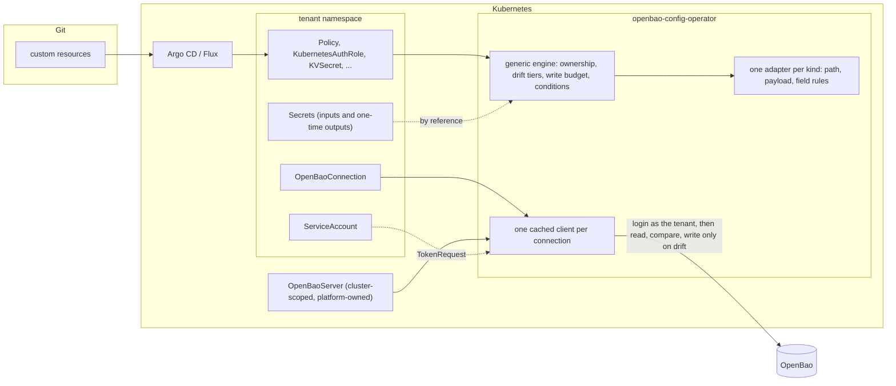

# openbao-config-operator

**Manage OpenBao configuration as Kubernetes resources: typed, multi-tenant, and silent at rest.**

<!-- Replace the Best Practices badge with https://www.bestpractices.dev/projects/<id>/badge once the project is registered. -->
[](https://github.com/alexandrust88/openbao-config-operator/actions/workflows/ci.yml)
[](https://github.com/alexandrust88/openbao-config-operator/actions/workflows/conformance.yml)
[](https://github.com/alexandrust88/openbao-config-operator/releases)
[](https://scorecard.dev/viewer/?uri=github.com/alexandrust88/openbao-config-operator)
[](https://www.bestpractices.dev/)
[](https://artifacthub.io/packages/search?repo=openbao-config-operator)
[](https://goreportcard.com/report/github.com/alexandrust88/openbao-config-operator)
[](LICENSE)
[](https://alexandrust88.github.io/openbao-config-operator/)

openbao-config-operator keeps the configuration of an existing [OpenBao](https://openbao.org) server in the
state that Kubernetes custom resources declare: policies, namespaces, mounts, auth methods and roles, secrets
engines, identity, the OIDC provider and MFA. One custom resource is one object at one OpenBao API path. Commit
YAML to Git, let Argo CD or Flux apply it, and the operator converges OpenBao, reports drift and repairs it.

It does not deploy, initialise, unseal or upgrade OpenBao, and it does not copy secret values into Kubernetes
(use [External Secrets Operator](https://external-secrets.io) for that).

> **Status: pre-release.** Every built-in kind is implemented and tested, but nothing is published yet: no tag,
> image or chart. The API group domain (`openbaoconfig.io`) is provisional and will be renamed once before
> v0.1.0 ([ADR 0008](docs/adr/0008-provisional-api-group-domain.md)). See the [roadmap](docs/maintainers/roadmap.md).

## Why

Platform teams that run OpenBao for many tenants want its configuration in Git, reviewed and reconciled like
everything else in the cluster. This operator is built for that case:

- one custom resource per OpenBao object, with typed and validated fields, and `OpenBaoEndpoint` for any path
  without a typed kind;
- a platform-owned `OpenBaoServer` and per-tenant connections that log in as the tenant's own ServiceAccount;
- adopt and orphan semantics, an `Observe` mode and an import tool for servers that already have configuration;
- drift detection on by default, with no writes while OpenBao matches the spec.

All of it runs on one generic engine; each kind adds a small adapter.

## Highlights

- **68 built-in kinds** (64 typed OpenBao kinds plus the server, connection and `OpenBaoEndpoint` kinds), every one
  reconciled against a real `bao server -dev` in CI, plus 52 plugin-gated kinds for external plugins
  ([kind catalogue](docs/kinds.md)). Typed kinds cover 87.0% of the configuration paths
  of OpenBao 2.7.2, measured per release in CI ([API coverage](docs/api-coverage.md)).
- **`OpenBaoEndpoint` escape hatch** for every path without a typed kind, with the same drift, ownership and
  delete-guard rules ([ADR 0006](docs/adr/0006-endpoint-escape-hatch.md)).
- **A real tenant boundary.** The platform team declares a cluster-scoped `OpenBaoServer` (address, CA, allowed
  namespaces and token audiences). A tenant's `OpenBaoConnection` logs in as a ServiceAccount of its own namespace
  through TokenRequest, never as the operator ([ADR 0003](docs/adr/0003-connections-and-tenant-boundary.md),
  [ADR 0010](docs/adr/0010-openbaoserver-owns-address-and-audiences.md)).
- **Silent at rest.** A steady-state reconcile reads and never writes; `openbao_writes_total` stays flat. The load
  test shows zero OpenBao and Kubernetes writes over three drift intervals at 5,000 objects
  ([load testing](docs/load-testing.md#steady-state)).
- **Drift tiers.** Access-critical kinds (policies, auth) are checked every 15 minutes and everything else hourly,
  with ±20% jitter and a per-server request budget; per-object overrides ([ADR 0014](docs/adr/0014-drift-tiers-and-request-budget.md)).
- **Adopt a running server safely.** `obc-import` reads a live OpenBao and writes custom resources in `Observe`
  mode, which reports drift and never writes. Switch them to `Manage` one at a time ([import](docs/import.md),
  [ADR 0016](docs/adr/0016-observe-mode-and-import-tool.md)).
- **Safe by default.** `creationPolicy: Create` and `deletionPolicy: Orphan` by default, one owner per path, a
  second guard before deleting mounts, namespaces, KV data or audit devices, and a write circuit breaker
  ([ADR 0013](docs/adr/0013-destructive-delete-guard.md), [ADR 0018](docs/adr/0018-write-circuit-breaker.md)).
- **No webhooks, no cert-manager.** Validation is OpenAPI and CEL in the CRDs ([ADR 0005](docs/adr/0005-cel-validation-without-webhooks.md)).
- **Secrets only by reference.** Inputs come from Kubernetes Secrets; write-only values are tracked as an HMAC in
  status and never appear in status, events, logs or metrics.
- **Supply chain.** The release workflow builds multi-arch distroless images, signs the images, the chart and the
  checksums with keyless cosign, and attests SPDX and CycloneDX SBOMs and provenance: GitHub artifact
  attestations (SLSA Build L2, as GitHub documents it) plus a cosign `slsaprovenance1` statement that the
  release job writes itself, which claims no SLSA level. Nothing reaches Build L3
  ([verify a release](SECURITY.md#verifying-releases)). Threat model and hardening guide in
  [docs/security](docs/security/).

## Quick start

Try it on a local [kind](https://kind.sigs.k8s.io) cluster with an in-memory OpenBao dev server. You need kind,
kubectl, Helm and Docker, and a clone of this repository.

**1. A cluster and an OpenBao dev server** (root token `root`, for trying out only):

```sh
kind create cluster --name obco
kubectl apply -f hack/e2e/openbao-dev.yaml
kubectl -n openbao rollout status deploy/openbao
kubectl create clusterrolebinding openbao-tokenreview \
  --clusterrole=system:auth-delegator --serviceaccount=openbao:default
```

**2. On the OpenBao side**, enable Kubernetes auth and let the ServiceAccount `team-a/openbao-config` manage
policies (in a real server, scope this policy to what the tenant may configure):

```sh
kubectl -n openbao exec -i deploy/openbao -- env BAO_ADDR=http://127.0.0.1:8200 BAO_TOKEN=root sh -s <<'EOF'
bao auth enable kubernetes
bao write auth/kubernetes/config kubernetes_host=https://kubernetes.default.svc
printf 'path "sys/policies/acl/*" { capabilities = ["create", "read", "update", "delete", "list"] }\n' |
  bao policy write team-a-config -
bao write auth/kubernetes/role/team-a-config \
  bound_service_account_names=openbao-config bound_service_account_namespaces=team-a \
  audience=openbao token_policies=team-a-config token_ttl=15m
EOF
```

**3. Install the operator** from the Helm repository (the same signed chart is also published as an OCI
artifact, see the [install guide](docs/operations/install.md)):

```sh
helm repo add openbao-config-operator https://alexandrust88.github.io/openbao-config-operator/charts
helm install openbao-config-operator openbao-config-operator/openbao-config-operator \
  --namespace openbao-config-operator --create-namespace --wait
```

Until the first release is published, build the image and install the chart from the clone instead:

```sh
make docker-build IMG=openbao-config-operator:dev
kind load docker-image openbao-config-operator:dev --name obco
helm install openbao-config-operator charts/openbao-config-operator \
  --namespace openbao-config-operator --create-namespace \
  --set image.repository=openbao-config-operator --set image.tag=dev
```

**4. Declare the server, a tenant connection and a policy:**

```sh
kubectl apply -f - <<'EOF'
apiVersion: core.openbaoconfig.io/v1alpha1
kind: OpenBaoServer
metadata:
  name: openbao
spec:
  address: http://openbao.openbao.svc:8200
  allowInsecureHTTP: true
  allowedNamespaces:
    matchLabels:
      openbaoconfig.io/tenant: "true"
  allowedAudiences:
    - openbao
---
apiVersion: v1
kind: Namespace
metadata:
  name: team-a
  labels:
    openbaoconfig.io/tenant: "true"
---
apiVersion: v1
kind: ServiceAccount
metadata:
  name: openbao-config
  namespace: team-a
---
apiVersion: core.openbaoconfig.io/v1alpha1
kind: OpenBaoConnection
metadata:
  name: openbao
  namespace: team-a
spec:
  serverRef:
    name: openbao
  auth:
    kubernetes:
      role: team-a-config
      serviceAccountRef:
        name: openbao-config
      audiences:
        - openbao
---
apiVersion: sys.openbaoconfig.io/v1alpha1
kind: Policy
metadata:
  name: app-read
  namespace: team-a
spec:
  connectionRef:
    name: openbao
  driftInterval: 30s
  policy: |
    path "secret/data/app/*" {
      capabilities = ["read"]
    }
EOF
kubectl get openbao -n team-a
```

`allowInsecureHTTP` is only for the dev server; real servers use `https://` and `caBundle`. `driftInterval: 30s`
makes the demo fast; the default for policies is 15 minutes. `Ready=True` means the policy in OpenBao matches the
spec, and `Synced=True` that the last reconcile succeeded.

**5. Watch drift repair.** Change the policy behind the operator's back, then read it again after half a minute:

```sh
kubectl -n openbao exec deploy/openbao -- env BAO_ADDR=http://127.0.0.1:8200 BAO_TOKEN=root \
  sh -c 'echo "path \"*\" { capabilities = [\"sudo\"] }" | bao policy write app-read -'
sleep 40
kubectl -n openbao exec deploy/openbao -- env BAO_ADDR=http://127.0.0.1:8200 BAO_TOKEN=root bao policy read app-read
kubectl describe policy.sys.openbaoconfig.io app-read -n team-a
```

The events name the keys that differed (never their values). Clean up with `kind delete cluster --name obco`.

## Architecture



One generic reconciler owns connections, finalizers, creation and deletion policy, conditions, events, metrics and
requeues; each kind contributes a small adapter with its path, payload and comparison rules
([ADR 0002](docs/adr/0002-generic-engine-with-adapters.md)). The full design is in
[docs/architecture.md](docs/architecture.md).

## Compatibility

| component | supported |
|-----------|-----------|
| OpenBao | 2.6 and 2.7 only ([ADR 0009](docs/adr/0009-openbao-only-target.md)); integration-tested on 2.7.2 only, 2.6 is API-compatible per its OpenAPI snapshot until the nightly matrix on every supported minor exists ([support window](docs/maintainers/release-process.md#openbao-versions)) |
| Kubernetes | 1.31 or later (chart `kubeVersion`); tested on envtest 1.35 and kind |

Kinds that need an OpenBao external plugin (cloud methods, LDAP, Kerberos, RADIUS) are disabled by default behind
`--enable-plugin-kinds` and report `Unsupported` until the plugin is mounted.

## Documentation

The full documentation is published at
[alexandrust88.github.io/openbao-config-operator](https://alexandrust88.github.io/openbao-config-operator/).

| | |
|---|---|
| [Install](docs/operations/install.md) and [connections](docs/operations/connections.md) | install modes, tenancy models, server and connection fields |
| [Kind catalogue](docs/kinds.md) | every kind, its path, availability and test evidence |
| [Import a running OpenBao](docs/import.md) | `obc-import` and observe mode |
| [Operations](docs/operations/) | Argo CD health, backup and restore, runbooks, troubleshooting |
| [Upgrade](docs/upgrade.md) | API compatibility, CRD upgrades, rollback |
| [Security](docs/security.md), [threat model](docs/security/threat-model.md), [hardening](docs/security/hardening.md) | controls, residual risks, recommended settings |
| [Architecture](docs/architecture.md) and [ADRs](docs/adr/) | design rules and decisions |
| [Load testing](docs/load-testing.md), [API coverage](docs/api-coverage.md), [verification](docs/verification.md) | the evidence behind the claims above |
| [Live testing](docs/live-testing.md) | a kustomize kit that applies every built-in kind to a running OpenBao, per connection mode |
| [Roadmap](docs/maintainers/roadmap.md) and [release process](docs/maintainers/release-process.md) | what comes next, versioning, support window, deprecation policy |

## Community

- Questions and ideas: [GitHub Discussions](https://github.com/alexandrust88/openbao-config-operator/discussions).
- Bugs and kind requests: [issues](https://github.com/alexandrust88/openbao-config-operator/issues/new/choose).
- Security reports: privately, see [SECURITY.md](SECURITY.md).
- How the project is run: [GOVERNANCE.md](GOVERNANCE.md), [MAINTAINERS.md](MAINTAINERS.md),
  [code of conduct](CODE_OF_CONDUCT.md), [support](SUPPORT.md), [community guide](docs/community/README.md).

## Contributing

Contributions are welcome, from docs fixes to new kinds. Start with [CONTRIBUTING.md](CONTRIBUTING.md), then pick a
[good first issue](https://github.com/alexandrust88/openbao-config-operator/labels/good%20first%20issue)
or a **help wanted** item on the [roadmap](docs/maintainers/roadmap.md). Adding a kind follows a fixed recipe in
[AGENTS.md](AGENTS.md#adding-a-kind): types, an adapter, unit and integration tests, an example.

## License

Apache License 2.0. See [LICENSE](LICENSE).
