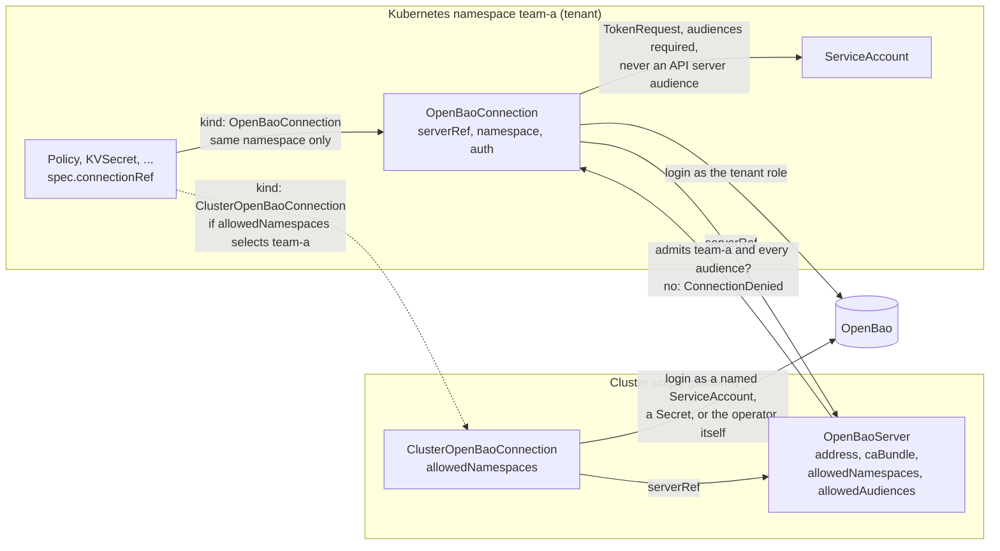
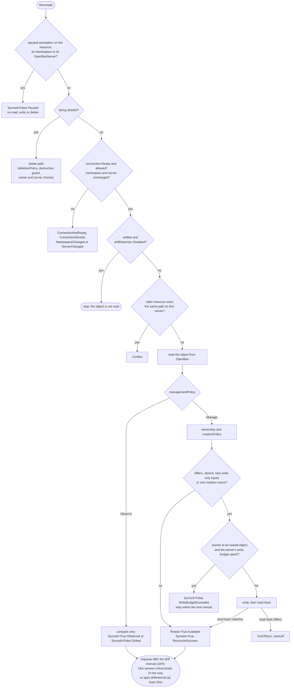
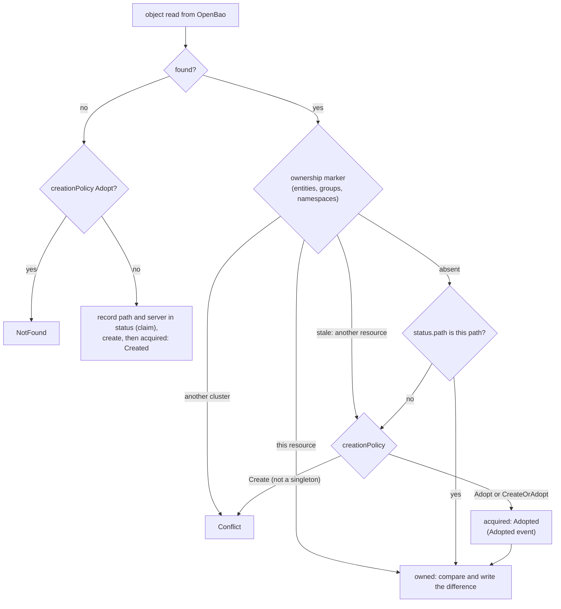

# Concepts

This page explains the mental model behind the operator: what it manages, how a tenant reaches
OpenBao, how one reconcile works and how the operator decides that an OpenBao object is its own.
[Architecture](../architecture.md) is the source of truth for the design; read this page first,
then the full design when you need the detail. The [decisions](../adr/README.md) list each choice
in one sentence. Exact condition reasons, status fields and events
are listed in [status and events](../reference/status-and-events.md).

## What the operator does

The operator keeps the configuration of an existing OpenBao server in the state that Kubernetes
custom resources declare. One custom resource is one object at one OpenBao API path: a policy, an
auth role, a mount, an entity. It does not deploy, initialise, unseal or upgrade OpenBao, and it
does not sync secret values into Kubernetes ([ADR 0007](../adr/0007-no-secret-sync.md)). It targets
OpenBao 2.6 and later only ([ADR 0009](../adr/0009-openbao-only-target.md),
[compatibility](../reference/compatibility.md)).

The model is closer to Terraform than to a secrets syncer: the spec is the desired state of a
remote API object, the operator reads that object, compares it field by field and writes only the
difference. Unlike Terraform there is no state file. The resource's own `status` records which
object it owns, and the OpenBao server itself is re-read on a schedule.

## Servers, connections and the tenant boundary

| kind | scope | owner | holds |
|------|-------|-------|-------|
| `OpenBaoServer` | cluster | platform | address, CA bundle, allowed namespaces and token audiences, rate limit |
| `OpenBaoConnection` | namespaced | tenant | `serverRef`, OpenBao namespace, how to log in |
| `ClusterOpenBaoConnection` | cluster | platform | the same, plus `allowedNamespaces`; may use the operator's own identity |

Every resource names a connection in `spec.connectionRef`. A tenant cannot choose the address,
borrow the operator's identity or mint a token the Kubernetes API server accepts; the OpenBao
policy bound to the tenant's ServiceAccount is the limit of what it can configure
([ADR 0003](../adr/0003-connections-and-tenant-boundary.md),
[ADR 0010](../adr/0010-openbaoserver-owns-address-and-audiences.md)). The operator keeps one
authenticated client per connection and renews its token instead of logging in on every reconcile.

The split follows who is trusted with what. The platform team decides where tokens may be sent
(the address and CA on `OpenBaoServer`) and which tenants may use a server. The tenant decides
which OpenBao role it logs in with, and OpenBao decides what that role may do. The operator's own
identity is reachable only through a `ClusterOpenBaoConnection`, which only the platform creates.

The checks in the diagram run in `internal/connection` before any credential is read: a
namespaced connection whose server does not select its namespace, or does not list one of its
audiences, is refused with `ConnectionDenied`, and a token audience that the Kubernetes API server
accepts is refused even when the server lists it. Field-level rules are in the
[connections reference](../reference/connections.md).

## Common spec and status

Every kind embeds the same spec fields: the immutable `connectionRef` and OpenBao `namespace`, and the policies
that decide how much the operator may do: `creationPolicy` (`Create` by default, or adopt an existing object,
[ADR 0015](../adr/0015-create-and-orphan-by-default.md)), `deletionPolicy` (`Orphan` by default), drift
detection and its interval, and `managementPolicy` (`Manage`, or `Observe` to read and report only,
[ADR 0016](../adr/0016-observe-mode-and-import-tool.md)). Defaults and meanings are in the
[architecture](../architecture.md#common-spec).

Status carries `Ready` (OpenBao matches the spec) and `Synced` (the last reconcile succeeded), and records which
object the resource owns: its full path, OpenBao namespace and server. Every field is listed in
[status and events](../reference/status-and-events.md#common-to-every-managed-kind).

## The engine

One generic reconciler serves every kind; each kind supplies a small adapter with its path, its
desired payload and its comparison rules ([ADR 0002](../adr/0002-generic-engine-with-adapters.md)).
The engine enforces the design rules:

1. A steady-state reconcile reads and does not write.
2. One path has one owner; a second resource on the same path gets `Conflict`
   ([ADR 0012](../adr/0012-ownership-path-index-and-marker.md)).
3. Create by default, adopt on request; retain by default, delete on request. Mounts, namespaces,
   KV data, audit devices, key material, MFA methods, entities and `OpenBaoEndpoint` also need the annotation
   `openbaoconfig.io/allow-destructive-delete: "true"`
   ([ADR 0013](../adr/0013-destructive-delete-guard.md)).
4. Secrets only by reference: secret inputs come from Kubernetes Secrets and never appear in a
   spec, status, event or log.
5. No root token at runtime.

One rule is followed by every adapter but not yet enforced by the engine: the spec is the whole desired state, so
removing a field writes its default back ([ADR 0011](../adr/0011-full-field-comparison.md)). The gaps are listed
under [not yet enforced](../architecture.md#not-yet-enforced), and the full numbered list is in the
[architecture](../architecture.md#design-rules).

Putting these rules in one engine, not in each kind, is what keeps more than a hundred kinds
consistent: an adapter cannot skip the ownership check, write on every pass or log a secret,
because it never performs those steps itself.

### One reconcile, and when the next one runs

A *settled* resource is one whose `Ready` and `Synced` conditions are both `True` for its current
generation, whose write-only hash and rotation nonce are unchanged and whose server is the one it
was acquired on. For a settled resource, a pass is a drift check: a read and a comparison, with no
write unless something outside the operator changed the object.

Drift checks run in two tiers ([ADR 0014](../adr/0014-drift-tiers-and-request-budget.md)). Kinds
that grant access (policies, auth mounts, every kind of the `auth` group, audit devices, groups,
group memberships and the access kinds) are re-read every 15 minutes; everything else every hour.
Both intervals are operator flags and get ±20% jitter so that thousands of objects do not hit the
server in the same second. All requests to one server share the token bucket of its
`OpenBaoServer.spec.rateLimit`, and drift reads go without priority, so a spec change is not
queued behind a drift sweep.

Two safety valves sit on the write side. The write circuit breaker
([ADR 0018](../adr/0018-write-circuit-breaker.md)) caps rewrites of objects the operator already
owns, with an unchanged spec and unchanged input Secrets, at 60 per minute per server by default:
creates, adoptions and spec changes are user-intended and never wait, but an operator upgrade
that changes a declared default cannot rewrite every object at once. The annotation
`openbaoconfig.io/paused: "true"` ([ADR 0019](../adr/0019-pause-annotation.md)) stops all reads,
writes and deletes, so an incident change made by hand is not reverted.

### Ownership and adoption

Before this decision the engine checks the path index: if an older resource already owns the same
absolute path on the same server, the newer one gets `Conflict` and never writes. Creates of one
path on one server are serialised inside the operator and re-read first, so of two `Create`
resources only the first creates the object. A resource that lost its status (a restore without
status, for example) is not recognised by status alone; kinds with a server-side marker recognise
their own object again, and the others need a one-time `Adopt`. The
[backup and restore guide](../operate/backup-restore.md) covers the kinds that keep state only in
status.

Ownership is also bound to the server. `status.serverID` holds the OpenBao cluster id, read
without a token from `sys/health`. If the connection later reaches another cluster (a DNS or load
balancer change, a re-initialised server), reconciling stops with `ServerChanged` and nothing is
written or deleted there.

## Kinds

Typed kinds cover the objects compiled into OpenBao, in the groups `core`, `sys`, `auth`,
`secrets`, `identity` and `access`, all `v1alpha1` under the domain `openbaoconfig.io`, which is final
([ADR 0008](../adr/0008-provisional-api-group-domain.md)). Kinds for external plugins are in the
code, experimental and disabled behind `--enable-plugin-kinds`. `OpenBaoEndpoint` writes any payload to any
path for everything without a typed kind ([ADR 0006](../adr/0006-endpoint-escape-hatch.md)).
Validation lives in the CRD schema (OpenAPI and CEL), with no admission webhooks
([ADR 0005](../adr/0005-cel-validation-without-webhooks.md)).

The `access` group builds on the primitives: `AccessLevel` names a set of capabilities,
`AccessGrant` gives workloads access through Kubernetes auth roles and
[templated policies](../guides/templated-policies.md), and `AccessLayout` gives people access through OIDC
groups.

See the [kind catalogue](../kinds.md) for the status of each kind and the
[API reference](../reference/api/index.md) for every field.
