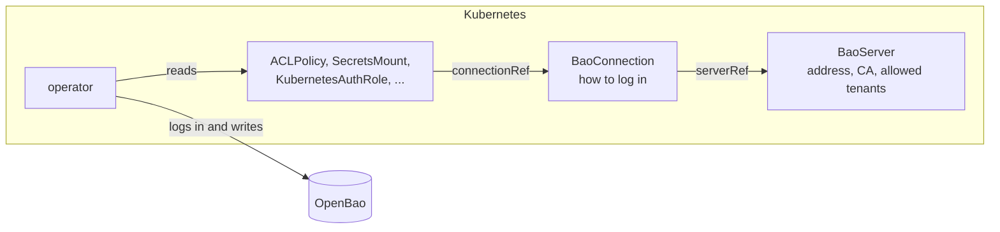

# Get started

OpenBao Config Operator manages the configuration of an OpenBao server that already runs: policies,
auth methods and roles, secrets engines, identities. You declare each object as a Kubernetes custom
resource; the operator writes it to OpenBao, checks it for drift and repairs it. The operator does
not install, initialise or unseal OpenBao.

## Choose a path

| you want to | start with | you are done when |
|-------------|------------|-------------------|
| try the operator on a local kind cluster that you delete afterwards | [Quickstart on kind](quickstart.md) | a policy, a KV mount, a Kubernetes auth role and a generated secret are `Ready`, a workload reads the secret, and the operator has repaired a change made behind its back |
| install the operator on a cluster you run | [Install](install.md) | the manager Deployment is available and `kubectl get crd` lists the `*.obco.dev` CRDs |
| point the operator at your OpenBao server | [Connect to OpenBao](connect.md) | `kubectl get baoserver` and `kubectl get baoconnection -A` show `Ready=True` |
| bring a server that is already configured under the operator | [Import existing configuration](../guides/import.md), then [Migrate to the operator](../guides/migration.md) | every imported resource reports `Synced=True` with reason `Observed`, then `Ready=True` in `Manage` mode |

!!! warning "The quickstart is for evaluation only"
    The quickstart runs OpenBao in dev mode: in-memory storage, plain HTTP and a well-known root
    token. Use it to learn the operator, never to hold real secrets. For a real cluster, follow
    [Install](install.md) and [Connect to OpenBao](connect.md).

## Before you begin

Every path needs:

- `kubectl` and a Kubernetes cluster at version 1.31 or later (the chart's `kubeVersion`);
- Helm 3.8 or later, for OCI charts;
- for any path except the quickstart, an initialised and unsealed OpenBao server that the operator
  pods can reach, and the rights to enable an auth method and write a policy in it.

## How the pieces fit

The platform team declares each OpenBao server once as a `BaoServer`. It also creates each
connection, which names the identity the operator logs in to that server as. Teams and tenants
create the resources, and every resource names its connection. The OpenBao policy behind the
connection's identity is the limit of what the resources can change.
[Concepts](../concepts/index.md) explains the model.

## Next steps

-   :material-book-open-variant: **[Guides](../guides/index.md)**

    ---

    Task-by-task: auth methods, secrets engines, identity, tenants.

-   :material-lightbulb-outline: **[Concepts](../concepts/index.md)**

    ---

    The model behind reconciliation, ownership, tenancy and deletion.

