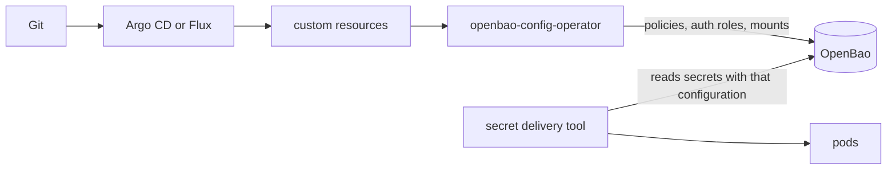

# Manage OpenBao configuration with Kubernetes and GitOps

OpenBao Config Operator configures an OpenBao server you already run: policies, auth methods,
secrets engines and OpenBao namespaces, each as a typed Kubernetes custom resource. It does not
deploy, initialise, unseal or upgrade OpenBao.
{ .obco-hero__pitch }

Status: 1.0.0, API `v1alpha1`, latest release @TAG@. For OpenBao 2.6 and 2.7 on Kubernetes 1.31 or later
([Compatibility](reference/compatibility.md)).

[Quickstart on kind](get-started/quickstart.md){ .md-button .md-button--primary }
[Install on a cluster](get-started/install.md){ .md-button }

[Kind catalogue](kinds.md) · [API reference](reference/api/index.md) · [Security](security.md)

## Choose a task

| You want to… | Follow this path |
|--------------|------------------|
| Learn the workflow from installation to a Ready policy | [Quickstart on kind](get-started/quickstart.md) |
| Define and update an ACL policy | [Manage OpenBao policies](guides/policies.md) |
| Reconcile OpenBao configuration from Git | [Argo CD](guides/argocd.md), [Flux](guides/flux.md) |
| Give each tenant, a team with its own Kubernetes namespace, an OpenBao namespace and a connection of its own | [Namespaces and tenants](guides/namespaces-and-tenants.md); to learn it on kind, [Onboard two tenants](tutorials/tenant-onboarding.md) |
| Configure OIDC login, JWT roles and group mappings | [JWT and OIDC authentication](guides/jwt-oidc-auth.md) |
| Adopt configuration already present in OpenBao | [Import existing OpenBao configuration safely](guides/import.md) |

## Why this operator

Keep OpenBao configuration in Git. Each object is one custom resource. Each tenant gets an OpenBao
namespace, OpenBao's own isolated set of policies, auth methods and mounts, which is separate from
the tenant's Kubernetes namespace. The platform team gives each tenant a connection that logs in
with an identity from the tenant's Kubernetes namespace, so that identity's OpenBao policy is the
limit of what the tenant can change. The operator writes only when OpenBao differs from the spec.

[Why this operator exists](concepts/why.md) compares it with other tools. The
[architecture decisions](adr/README.md) list each choice in one sentence.

The product version is 1.0.0 and the API is `v1alpha1`: fields can still change in a minor release under the
[deprecation policy](reference/compatibility.md#deprecation-policy). The API groups are `<area>.obco.dev/v1alpha1`,
under a domain the project owns.
Check the [known limitations](reference/limitations.md) before you point the operator at production
configuration.

## Features

-   :material-code-braces:{ .lg .middle } **Typed OpenBao configuration**

    ---

    One custom resource is one object at one OpenBao API path, such as a policy, an auth role or a
    secrets engine. `BaoEndpoint` covers any path without a typed kind.

    [:octicons-arrow-right-24: Kind catalogue](kinds.md)

-   :material-account-lock:{ .lg .middle } **Each tenant logs in as itself**

    ---

    The platform team creates the `BaoServer` and each tenant's `BaoConnection`. The connection
    logs in with an identity from the tenant's Kubernetes namespace, never as the operator, and that
    identity's OpenBao policy is the limit.

    [:octicons-arrow-right-24: Connections](reference/connections.md)

-   :material-volume-off:{ .lg .middle } **No writes in steady state**

    ---

    A steady-state reconcile reads and does not write. The load test recorded zero OpenBao writes and zero
    Kubernetes writes in steady state at up to 5,000 objects.

    [:octicons-arrow-right-24: Load testing](operate/load-testing.md#steady-state)

-   :material-timer-sync-outline:{ .lg .middle } **Scheduled drift checks**

    ---

    Access-critical kinds such as policies and auth roles are re-read every 15 minutes, everything else every
    hour, inside a per-server request budget. Each resource can set its own interval.

    [:octicons-arrow-right-24: Constants and timings](reference/constants.md)

-   :material-import:{ .lg .middle } **Import existing configuration**

    ---

    `obc-import` reads a running OpenBao and writes custom resources in `Observe` mode, which reports drift and
    never writes. Switch them to `Manage` one at a time.

    [:octicons-arrow-right-24: Import existing OpenBao configuration safely](guides/import.md)

-   :material-shield-check:{ .lg .middle } **Conservative defaults**

    ---

    `creationPolicy: Create` and `deletionPolicy: Orphan` by default, one owner per path, and an extra
    annotation before deleting data such as mounts, OpenBao namespaces and KV data.

    [:octicons-arrow-right-24: Security](security.md)

## Where it fits

The operator configures OpenBao. It does not sync secret values from OpenBao into Kubernetes
([ADR 0007: no OpenBao-to-Kubernetes secret sync](adr/0007-no-secret-sync.md)).

- **Configuration as code.** Argo CD, Flux or `kubectl apply` put the custom resources in the cluster; the
  operator converges OpenBao to them. The [Argo CD](guides/argocd.md) and [Flux](guides/flux.md) guides deploy OpenBao, the operator and its configuration from Git end to end.
- **Secret delivery is a separate job.** Getting secret values into pods is done by tools such as External Secrets
  Operator or the Secrets Store CSI Driver. A typical split: the operator
  writes the policy and the Kubernetes auth role, and the delivery tool logs in with that role to read the secret.
- **Values written to Kubernetes.** Six kinds can write a value to a Kubernetes Secret they own, through
  `writeSecretRef`: the password a `RandomSecret` generates, and values OpenBao returns only once: an
  AppRole secret ID (`AppRoleSecretID`), OIDC client credentials (`OIDCClient`), a TOTP key URL and
  QR code (`TOTPKey`), and an exported private key (`PKIIssuer`, `PKIKey`).
