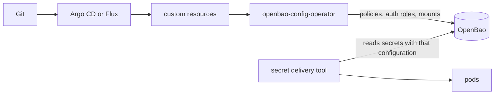

# Manage OpenBao configuration with Kubernetes and GitOps

A Kubernetes operator for GitOps management of an existing OpenBao server: policies, auth methods, secrets
engines and tenant namespaces as typed custom resources.
{ .obco-hero__pitch }

[Quickstart on kind](get-started/quickstart.md){ .md-button .md-button--primary }
[Install on a cluster](get-started/install.md){ .md-button }

[Supported resources](kinds.md) · [API reference](reference/api/index.md) · [Security model](security.md)

The operator manages the configuration of an existing OpenBao server. Server deployment, unsealing and upgrades
remain separate; secret delivery tools such as External Secrets Operator consume the configured policies and auth roles.

## Choose a task

| You want to… | Follow this path |
|--------------|------------------|
| Learn the workflow from installation to a Ready policy | [Quickstart on kind](get-started/quickstart.md) |
| Define and update an ACL policy | [Manage OpenBao policies](guides/policies.md) |
| Give teams their own OpenBao namespaces and identities | [Tenant onboarding](tutorials/tenant-onboarding.md) |
| Reconcile OpenBao configuration from Git | [Argo CD integration](guides/argocd.md) |
| Configure OIDC login, JWT roles and group mappings | [JWT and OIDC authentication](guides/jwt-oidc-auth.md) |
| Adopt configuration already present in OpenBao | [Import and observe mode](guides/import.md) |

## Why this operator

Keep OpenBao configuration in Git. Each object is one custom resource, and each tenant logs in through a
connection in its own namespace, so that tenant's OpenBao policy is the limit of what it can change. The
operator writes only when OpenBao differs from the spec.

[Why this operator exists](concepts/why.md) compares it with other tools. The [decisions](adr/README.md) list
each architecture choice in one sentence.

!!! warning "Status: alpha"

    @TAG@ is the latest release. The API is `v1alpha1`, so a minor release may change it under the
    [deprecation policy](maintainers/release-process.md#deprecation-policy); the API group domain
    `openbaoconfig.io` is final ([ADR 0008](adr/0008-provisional-api-group-domain.md)). Check the
    [known limitations](reference/limitations.md) before you point the operator at production configuration.

## Features

-   :material-code-braces:{ .lg .middle } **Typed OpenBao configuration**

    ---

    One custom resource is one object at one OpenBao API path: policies, namespaces, mounts, auth methods and
    roles, secrets engines, identity, the OIDC provider and MFA. `OpenBaoEndpoint` covers any path without a
    typed kind.

    [:octicons-arrow-right-24: Kind catalogue](kinds.md)

-   :material-account-lock:{ .lg .middle } **Tenants act as themselves**

    ---

    The platform team owns `OpenBaoServer`. A tenant's `OpenBaoConnection` logs in with an identity from that
    tenant's namespace, never as the operator. The tenant's OpenBao policy is the limit.

    [:octicons-arrow-right-24: Connections](reference/connections.md)

-   :material-volume-off:{ .lg .middle } **Silent at rest**

    ---

    A steady-state reconcile reads and does not write. The load test recorded zero OpenBao writes and zero
    Kubernetes writes in steady state at up to 5,000 objects.

    [:octicons-arrow-right-24: Load test results](operate/load-testing.md#steady-state)

-   :material-timer-sync-outline:{ .lg .middle } **Drift tiers**

    ---

    Access-critical kinds such as policies and auth roles are re-read every 15 minutes, everything else every
    hour, inside a per-server request budget. Each resource can set its own interval.

    [:octicons-arrow-right-24: Intervals](reference/constants.md)

-   :material-import:{ .lg .middle } **Observe and import**

    ---

    `obc-import` reads a running OpenBao and writes custom resources in `Observe` mode, which reports drift and
    never writes. Switch them to `Manage` one at a time.

    [:octicons-arrow-right-24: Import existing configuration](guides/import.md)

-   :material-shield-check:{ .lg .middle } **Safe by default**

    ---

    `creationPolicy: Create` and `deletionPolicy: Orphan` by default, one owner per path, a second guard before
    deleting mounts, namespaces, KV data, audit devices, key material, MFA methods, entities or the target of an
    `OpenBaoEndpoint`, and validation in the CRDs with no webhooks.

    [:octicons-arrow-right-24: Security model](security.md)

## Where it fits

The operator configures OpenBao. It does not deploy, initialise, unseal or upgrade OpenBao, and it does not copy
secret values into Kubernetes ([ADR 0007](adr/0007-no-secret-sync.md)).

- **Configuration as code.** Argo CD, Flux or `kubectl apply` put the custom resources in the cluster; the
  operator converges OpenBao to them. The [Argo CD guide](guides/argocd.md) adds a health check for every kind.
- **Secret delivery is a separate job.** Getting secret values into pods is done by tools such as External Secrets
  Operator or the Secrets Store CSI Driver. A typical split: this operator
  writes the policy and the Kubernetes auth role, and the delivery tool logs in with that role to read the secret.
- **One exception.** When OpenBao returns a generated value only once, such as an AppRole secret ID, the operator
  writes that value to a Kubernetes Secret it owns, through `writeSecretRef`.
