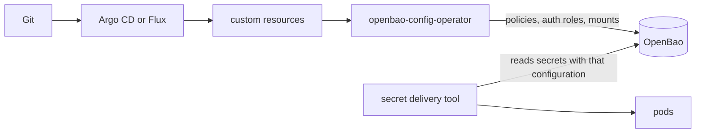

<div class="obco-hero" markdown>

# openbao-config-operator

Manage the configuration of an existing OpenBao server as Kubernetes custom resources: typed, multi-tenant and
silent at rest.
{ .obco-hero__pitch }

[Get started](get-started/index.md){ .md-button .md-button--primary }
[Quickstart on kind](get-started/quickstart.md){ .md-button }

</div>

## Why this operator

Platform teams that run OpenBao for many tenants want its configuration in Git, reviewed and reconciled like the
rest of the cluster. The operator gives each OpenBao object a typed custom resource, and each tenant configures
OpenBao through its own connection, logged in with an identity of its own namespace (a ServiceAccount, or a
token or AppRole from a Secret there), so the OpenBao policy bound to that identity is the limit of what the tenant can change. It re-reads OpenBao on a drift schedule, writes only
when OpenBao differs from the spec, and can observe and import a server that already has configuration before it
takes over.

!!! warning "Status: alpha"

    v0.1.0 and v0.1.1 are released. The API is `v1alpha1`, so a minor release may change it under the
    [deprecation policy](maintainers/release-process.md#deprecation-policy); the API group domain
    `openbaoconfig.io` is final ([ADR 0008](adr/0008-provisional-api-group-domain.md)). Check the
    [known limitations](reference/limitations.md) before you point the operator at production configuration.

## Features

<div class="grid cards" markdown>

-   :material-code-braces:{ .lg .middle } **One typed kind per OpenBao API**

    ---

    One custom resource is one object at one OpenBao API path: policies, namespaces, mounts, auth methods and
    roles, secrets engines, identity, the OIDC provider and MFA. `OpenBaoEndpoint` covers any path without a
    typed kind.

    [:octicons-arrow-right-24: Kind catalogue](kinds.md)

-   :material-account-lock:{ .lg .middle } **Tenants act as themselves**

    ---

    The platform team owns the cluster-scoped `OpenBaoServer`: address, CA, allowed namespaces and token
    audiences. A tenant's `OpenBaoConnection` logs in with a ServiceAccount, token or AppRole of its own namespace,
    never as the operator. The tenant's OpenBao policy is the limit; the [e2e tests](https://github.com/alexandrust88/openbao-config-operator/tree/main/test/e2e) exercise it, and
    the [known limitations](reference/limitations.md#verification) say what is not proven yet; a two-tenant e2e
    test is being added.

    [:octicons-arrow-right-24: Connections](reference/connections.md)

-   :material-volume-off:{ .lg .middle } **Silent at rest**

    ---

    A steady-state reconcile reads and does not write. The load test recorded zero OpenBao writes and zero
    Kubernetes writes in steady state at up to 5,000 objects.

    [:octicons-arrow-right-24: Load test results](operate/load-testing.md#steady-state)

-   :material-timer-sync-outline:{ .lg .middle } **Drift tiers**

    ---

    Access-critical kinds such as policies and auth roles are re-read every 15 minutes, everything else every
    hour, inside a per-server request budget. Each resource can set its own interval.

    [:octicons-arrow-right-24: ADR 0014](adr/0014-drift-tiers-and-request-budget.md)

-   :material-import:{ .lg .middle } **Observe and import**

    ---

    `obc-import` reads a running OpenBao and writes custom resources in `Observe` mode, which reports drift and
    never writes. Switch them to `Manage` one at a time.

    [:octicons-arrow-right-24: Import existing configuration](guides/import.md)

-   :material-shield-check:{ .lg .middle } **Safe by default**

    ---

    `creationPolicy: Create` and `deletionPolicy: Orphan` by default, one owner per path, a second guard before
    deleting mounts, namespaces, KV data, audit devices, key material, MFA methods, entities or the target of an
    `OpenBaoEndpoint`, and validation in the CRDs with no webhooks.

    [:octicons-arrow-right-24: Security model](security.md)

</div>

## A 60-second example

A tenant declares an OpenBao ACL policy in Git. The policy uses identity templating, and `accessorRefs` lets it
name auth mounts by placeholder instead of hard-coding their accessors.

=== "1. The manifest"

    ```yaml
    --8<-- "examples/sys/policy.yaml"
    ```

=== "2. What the operator does"

    1. Resolves `connectionRef` to the `OpenBaoConnection` named `openbao` and uses the authenticated client it
       keeps for that connection.
    2. Waits until the `AuthMount` resources `obco-kubernetes` and `obco-approle` report their accessors, then
       replaces `${accessor:k8s}` and `${accessor:ci}` in the policy text.
    3. Reads `sys/policies/acl/team-a-reader`. With `creationPolicy: CreateOrAdopt` it creates the policy when it
       is missing and adopts it when it exists, and it writes only when OpenBao differs from the spec.
    4. Re-reads the policy every 15 minutes (`driftInterval`) and repairs drift. The `Updated` event names the keys
       that differed, never their values.
    5. Deletes the policy from OpenBao when you delete the resource, because `deletionPolicy` is `Delete`. The
       default, `Orphan`, leaves it in place.

=== "3. The status you see"

    `Ready=True` means the policy in OpenBao matches the spec. `Synced=True` means the last reconcile succeeded.

    ```sh
    kubectl get policy.sys.openbaoconfig.io obco-team-a-reader -n openbao-config
    ```

    ```text
    NAME                 READY   SYNCED   AGE
    obco-team-a-reader   True    True     40s
    ```

    The status records the OpenBao path and how the operator came to own the object (trimmed):

    ```yaml
    status:
      conditions:
        - type: Ready
          status: "True"
          reason: Available
        - type: Synced
          status: "True"
          reason: ReconcileSuccess
      observedGeneration: 1
      path: sys/policies/acl/team-a-reader
      acquired: Created
    ```

    When the connection works in an OpenBao namespace, `path` starts with that namespace.

More examples, one for every kind, are in the [examples gallery](reference/examples/index.md).

## Where it fits

The operator configures OpenBao. It does not deploy, initialise, unseal or upgrade OpenBao, and it does not copy
secret values into Kubernetes ([ADR 0007](adr/0007-no-secret-sync.md)).



- **Configuration as code.** Argo CD, Flux or `kubectl apply` put the custom resources in the cluster; the
  operator converges OpenBao to them. The [Argo CD guide](guides/argocd.md) adds a health check for every kind.
- **Secret delivery is a separate job.** Getting secret values into pods is done by tools such as External Secrets
  Operator, the Secrets Store CSI Driver or Vault Secrets Operator-style operators. A typical split: this operator
  writes the policy and the Kubernetes auth role, and the delivery tool logs in with that role to read the secret.
- **One exception.** When OpenBao returns a generated value only once, such as an AppRole secret ID, the operator
  writes that value to a Kubernetes Secret it owns, through `writeSecretRef`.

## Next steps

- [Choose a path](get-started/index.md): evaluate on kind, install on a cluster or import existing configuration.
- [Concepts](concepts/index.md): servers, connections, the engine and its design rules.
- [API reference](reference/api/index.md): every kind and field, generated from the CRDs.
