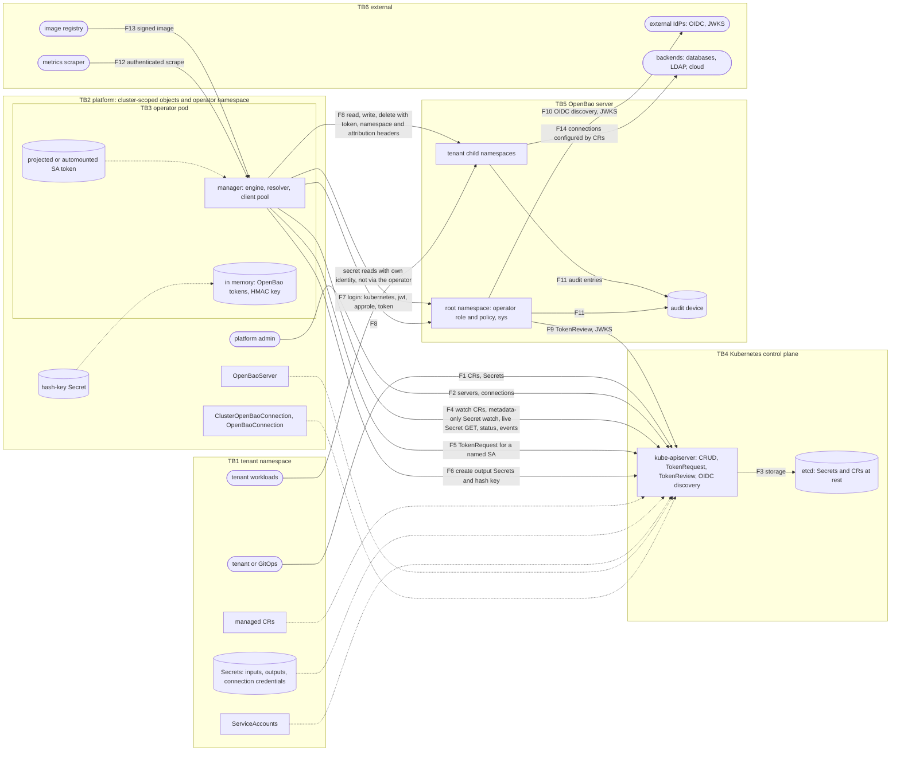

# Threat model

This page is the threat model of openbao-config-operator v2: what it protects, from whom, through
which trust boundaries, and which control in the code or the deployment answers each threat. The
hardening checklist that follows from it is [hardening.md](hardening.md). The design it models is
[architecture.md](../architecture.md); the shorter overview is [security.md](../security.md).

Every control is cited as `file:line` against the current tree (refreshed after the security
fixes of 2026-11-14). A threat without a control found in the code or the shipped chart is marked
**GAP**.

## Gaps and weak defaults

The first version of this model listed eight gaps: controls that the architecture or security pages
claimed, or that the threats need, and that the code did not provide or provided with a default
that failed open. An independent review of the implementation against the model
(BL-008) then found six more weaknesses, N1 to N6, and one item to document, N7
([N-threats](#n-threats-from-the-independent-review)). The table shows where each gap stands now.

| id | severity | finding | status | control now | threats |
|----|----------|---------|--------|-------------|---------|
| GAP-01 | High | `ClusterOpenBaoConnection.spec.allowedNamespaces` unset admitted every namespace, while `OpenBaoServer` unset admitted none. | closed | unset denies every namespace, `{}` allows all, as on `OpenBaoServer` (`internal/connection/resolver.go:239-247`; CRD text `api/core/v1alpha1/clusteropenbaoconnection_types.go:29-31`) | T-01 |
| GAP-02 | Medium | The API server audience check applied to tenant connections only; a cluster connection with `serviceAccountRef` and empty `audiences` got an API-server-valid token. | closed | CEL requires `audiences` with `serviceAccountRef` (`clusteropenbaoconnection_types.go:86,115`); the resolver requires them and refuses API server audiences for cluster connections too (`resolver.go:310,378-391`) | T-15 |
| GAP-03 | High | The default cluster-connection login sent the operator's automounted API server token to OpenBao. | closed | the default token file is the chart's projected token (`resolver.go:41`, `clusteropenbaoconnection_types.go:75`), projected token on by default (`charts/openbao-config-operator/values.yaml:52-63`); CEL refuses the automount directory (`clusteropenbaoconnection_types.go:67,78`); the resolver refuses it by path and, after N5, by file identity, and refuses a token whose `aud` is an API server audience (`resolver.go:527-537,555-576`) | T-16 |
| GAP-04 | Medium | `OpenBaoServer.spec.address` accepted `http://` silently. | closed | CEL requires `https://` unless `allowInsecureHTTP: true` (`openbaoserver_types.go:8,18`); the resolver checks again for both connection kinds (`resolver.go:332-334`) | T-17, T-28 |
| GAP-05 | Low | The OpenBao API client followed one redirect to any host with the token and body. | closed | `DisableRedirects` and a retry check that refuses any 3xx (`internal/openbao/client.go:276-281,298-299`) | T-29 |
| GAP-06 | Medium | No `AuditRequestHeader` example, so the attribution header never reached the audit log. | closed | `examples/sys/auditrequestheader-attribution.yaml` (`hmac: false`) | T-32 |
| GAP-07 | Medium | The chart's NetworkPolicy was off by default; with empty peers, egress is open on 443, 6443 and 8200. | closed (backlog BL-013); empty peers still allow any destination on those ports | on by default with a `kubernetes` or `cilium` flavour (`values.yaml:202-208`, `templates/networkpolicy.yaml:1`, `templates/ciliumnetworkpolicy.yaml:1`); with empty `apiServer.cidrs` or `openbao.to` the egress rules have no `to` (`templates/networkpolicy.yaml:49-69`) and the install notes warn (`templates/NOTES.txt:29-34`); see [R-NETWORK-01](hardening.md#r-network-01-enable-the-networkpolicy) | T-19 |
| GAP-08 | Low | Write-only redaction covered only top-level strings. | closed | recursive over maps and lists (`internal/engine/reconciler.go:1584-1626`); values shorter than 4 characters and encoded echoes are not redacted (accepted) | T-21 |
| N1 | Medium | `spec.driftInterval` had no lower bound, so a tenant could run a hot read loop. | closed | CEL minimum 30 s (`api/common/v1alpha1/types.go:120`); engine floor (`internal/engine/drift.go:40-47`) | N1, T-10 |
| N2 | Medium | `..` segments in path fields reached the API client, which cleans them, so paths escaped their kind and the path index. | closed | `ValidatePath` in `locate()` (`reconciler.go:418-422`) and before every request (`client.go:36,56,78,93,205-216`) | N2, T-08 |
| N3 | Medium | `OpenBaoEndpoint` could delete mounts or namespaces through `deletePath` without the destructive annotation. | closed | `OpenBaoEndpoint` is destructive (`internal/controller/core/openbaoendpoint.go:60`) | N3, T-09 |
| N4 | Low | A self-added finalizer on a CR naming a denied cluster connection blocked the connection's deletion. | closed | in-use counting ignores holders the connection or server does not admit (`internal/controller/core/connection_controller.go:216`, `server_controller.go:96`, `resolver.go:250-261`) | N4 |
| N5 | Low | The automounted-token guard was lexical (`/proc/self/root/...` passed). | closed | file identity plus `aud` check (`resolver.go:527-537,555-576`) | T-16 |
| N6 | Low | The import CLI set `allowInsecureHTTP` silently and wrote world-readable files. | closed | warning in the summary, files 0600 ([import.md](../guides/import.md)) | T-17 |
| N7 | Low | Pause, path index and observe: documentation items. | documented | [N7](#n-threats-from-the-independent-review) | N7 |

Residual risks that follow from defaults rather than missing code: the chart installs cluster-wide
by default (RR-01), and the platform identity in the self-init example can rewrite its own policy
(RR-02). See [residual risks](#residual-risks-and-recommendations).

## Method

The model follows two references.

- The cert-manager [threat modelling](https://cert-manager.io/docs/devops-tips/threat-modelling/)
  page: state who should interact with each resource, write each risk as a **privilege
  equivalence** ("permission to edit an Issuer is permission to read Secrets in its namespace"),
  and give multi-tenant clusters their own section. The
  [privilege equivalences](#privilege-equivalences) section applies this.
- The ControlPlane *cert-manager End User Threat Model and Hardening Guide* (March 2026, fetched
  as the PDF linked from the cert-manager announcement): scope, threat landscape with a CIA
  impact rating, threat actors with capability, motivation and sample attacks, a data dictionary,
  architecture and data flows, findings `T-nn` with severity, impact, description and
  recommendations, and hardening recommendations `R-<CATEGORY>-nn` with a priority and the threats
  they mitigate. This page keeps that structure; [hardening.md](hardening.md) holds the `R-`
  items.

Threats are listed per trust boundary and classified with STRIDE (Spoofing, Tampering,
Repudiation, Information disclosure, Denial of service, Elevation of privilege). The guide's
MITRE ATT&CK and NIST SP 800-53 mappings are left out.

Ratings:

| rating | likelihood | impact |
|--------|------------|--------|
| H | an actor in scope can do it with the permissions the default install gives it | loss of control over OpenBao or the cluster, or exposure of credentials across tenants |
| M | needs a misconfiguration, a second weakness or an insider | one tenant's OpenBao objects or secrets, or a cluster-wide outage of reconciliation |
| L | needs a privileged actor acting against the platform, or several weaknesses | one object, or noise without data exposure |

Severity is the higher of the two ratings when both are at least M, and otherwise the lower one.
A **status** of `control` means the code or chart implements the control; `partial` means it
exists with a gap; `residual` means the risk is accepted or depends on configuration outside the
operator; `GAP` means no control was found.

## Scope

In scope:

- the manager (`cmd/main.go`), the engine (`internal/engine`), the connection resolver
  (`internal/connection`), the OpenBao client (`internal/openbao`), the CRDs (`api/`) and the Helm
  chart (`charts/openbao-config-operator`);
- the OpenBao-side configuration the operator depends on: its own auth role and policy, tenant
  roles and policies, audit settings and self-init;
- multi-tenant use: several Kubernetes namespaces sharing one OpenBao server, each confined to
  its own OpenBao namespace.

Out of scope:

- the OpenBao server itself (seal, storage, raft, its own vulnerabilities), the Kubernetes control
  plane and the nodes;
- the import CLI `cmd/obc-import`, which runs with a human's token on a workstation (it never
  reads secret values: `internal/importer/importer.go:37,239-243`);
- the supply chain of the project itself (maintainers, dependencies); only verification by the
  user is covered;
- advanced persistent threats and unsupported versions.

Assumptions, as in the ControlPlane guide, which shift the ratings when they do not hold:

- soft multi-tenancy: tenants share nodes and the API server and are separated by namespaces,
  RBAC and OpenBao namespaces;
- standard Kubernetes RBAC; the chart's user roles are aggregated into `admin` and `edit`
  (`values.yaml:77-81`);
- OpenBao 2.6 or later with namespaces, auto-unseal and self-init;
- etcd encryption at rest is the cluster operator's responsibility.

## System description

The operator watches custom resources and keeps one OpenBao object per resource in the declared
state. It never deploys, initialises or unseals OpenBao, and never copies secret values from
OpenBao into Kubernetes, except values OpenBao returns once (`writeSecretRef`).

Objects and owners:

| object | scope | written by | role in the boundary |
|--------|-------|------------|----------------------|
| `OpenBaoServer` | cluster | platform admin | the only place an address, CA bundle, rate limit and timeout are set; `allowedNamespaces` and `allowedAudiences` gate tenants |
| `ClusterOpenBaoConnection` | cluster | platform admin | may use the operator's identity (injected token, token file) and Secrets or ServiceAccounts in any namespace |
| `OpenBaoConnection` | namespaced | platform admin (the chart's tenant role excludes it, `templates/rbac/user-roles.yaml:14-16`) | logs in with a ServiceAccount, a token or an AppRole of its own namespace |
| managed kinds (`Policy`, `KubernetesAuthRole`, `KVSecret`, `OpenBaoEndpoint`, ...) | namespaced | tenant, through `<release>-tenant-editor` | one OpenBao object each, through a connection |
| hash-key Secret | operator namespace | the manager, on first start | HMAC key of `status.writeOnlyHash` |
| output Secrets | tenant namespace | the manager | one-time values (secret IDs, client secrets) |

Reconcile in one paragraph: the engine resolves the connection (`internal/connection/resolver.go:113-142`), checks the
pause annotations (`reconciler.go:1115-1135`), validates the relative OpenBao namespace
(`reconciler.go:331-335`), refuses a path an older resource owns (`reconciler.go:433-441`),
builds the desired payload with Secret values read live (`internal/engine/resolver.go:25-38`),
reads the object, applies `creationPolicy`, writes only on a difference and inside the
per-server write budget (`reconciler.go:784-794`), writes one-time outputs to an owned Secret
(`reconciler.go:1364-1390`) and records status. Every request carries
`X-Openbao-Config-Resource: <group>/<kind>/<namespace>/<name>` (`reconciler.go:256,311-313`).

## Data-flow diagram

Trust boundaries are the dashed groups. Flow numbers are used in the threat tables.

Boundaries:

| id | boundary | crossed by |
|----|----------|------------|
| TB1 | tenant namespace to the API server | F1: tenants write CRs and Secrets; the operator reads them back across TB3 |
| TB2 | platform-owned cluster-scoped objects and the operator namespace | F2: only platform admins write servers and connections |
| TB3 | operator pod to the API server | F4 to F6: the manager's Kubernetes identity |
| TB4 | API server to etcd | F3: Secrets and CRs at rest; out of the operator's control |
| TB5 | operator to OpenBao, and between OpenBao namespaces | F7, F8: network and OpenBao identity; namespaces separate tenants inside the server |
| TB5/TB4 | OpenBao to the API server | F9: OpenBao reviews the tokens the operator presents |
| TB6 | OpenBao to external IdPs and backends, registry and scrapers | F10, F13, F14, F12 |

## Assets

Data dictionary, rated for confidentiality, integrity and availability as in the ControlPlane
guide.

| id | asset | where | C | I | A |
|----|-------|-------|---|---|---|
| A1 | operator OpenBao identities: tokens of every connection; the platform identity of `ClusterOpenBaoConnection` | manager memory (`internal/openbao/pool.go`), never in status | H | H | M |
| A2 | the manager's Kubernetes identity: Secrets get/list/watch/create/update/patch and `serviceaccounts/token` create, cluster-wide by default | ServiceAccount token in the pod; `templates/rbac/_manager-rules.tpl:60-77`, `templates/rbac/manager.yaml:12-14` | H | H | M |
| A3 | TokenRequest power: a 10-minute token for any ServiceAccount the manager's RBAC covers, for any audience | `resolver.go:56-57,609-619` | H | H | L |
| A4 | connection credentials: static tokens, AppRole role and secret IDs | Secrets referenced by connections | H | H | M |
| A5 | secret inputs: passwords, JWTs, client secrets, private keys | Secrets referenced by `<field>SecretRef` | H | M | M |
| A6 | one-time outputs: secret IDs, OIDC client secrets | owned Secrets from `writeSecretRef` | H | M | M |
| A7 | HMAC key of `status.writeOnlyHash` | immutable Secret in the operator namespace (`internal/engine/hashkey.go:21-50`) | M | M | L |
| A8 | OpenBao configuration: policies, auth roles, mounts, identities | OpenBao | M | H | H |
| A9 | OpenBao audit trail, including the attribution header | OpenBao audit devices | M | H | M |
| A10 | CR status: `path`, `namespace`, `acquired` steer later writes and deletes | status subresources | L | H | M |
| A11 | `OpenBaoServer` and connection definitions: where credentials are sent | cluster-scoped and namespaced CRs | L | H | H |

## Threat actors

In scope:

| actor | capability | motivation | sample attacks on this operator |
|-------|------------|------------|---------------------------------|
| tenant (namespace `admin` or `edit`) | create and edit managed kinds and Secrets in its namespace; no connections, no status writes | lateral movement, more access in OpenBao, convenience | reference a `ClusterOpenBaoConnection`; adopt an object it does not own; route a Secret into OpenBao; flood objects |
| malicious CR author (a compromised Git repository or pipeline, or a user bound only to `<release>-tenant-editor`) | the same CR verbs, possibly without Secret read | exfiltration, sabotage | push a namespace's Secret into a KV path it can read; set `deletionPolicy: Delete` and the destructive annotation |
| platform admin | servers, connections, the operator's OpenBao policy, chart values | operational shortcuts; insider misuse | cluster connection without `allowedNamespaces`; `http://` address; API server audience token for a privileged ServiceAccount |
| cluster admin | everything | insider misuse | read the hash key or output Secrets; patch status to steer a delete; replace the image. Trusted; listed so that the controls that do not rely on trusting it are visible |
| compromised workload (a tenant pod, or a sidecar injected into the operator pod) | its own ServiceAccount and network position | escalation | read the operator's automounted token; reach OpenBao or the API server from the pod network |
| network attacker (pod network, or the path between the cluster and OpenBao) | observe or alter traffic | credential theft | capture tokens over `http://`; redirect the client |

Out of scope: the project's own maintainers and dependencies (supply chain), APT groups, and an
attacker who already controls the OpenBao server or etcd.

## Privilege equivalences

Following the cert-manager page, each line states what a Kubernetes permission really grants.

| permission | is equivalent to | why |
|------------|------------------|-----|
| create or edit any managed kind in namespace N that uses connection C | everything C's OpenBao policy allows, in C's OpenBao namespace | the operator adds no authority of its own; the policy is the limit (`docs/operate/openbao-policy.md`) |
| the same, without `get` on Secrets in N | reading any Secret in N whose value the author can route into an OpenBao path it can read back (for example `OpenBaoEndpoint.dataSecretRef`, or `KVSecret.dataFrom`, which copies a whole Secret) | `*SecretRef` is resolved with the manager's RBAC, not the author's; there is no SubjectAccessReview (`internal/engine/resolver.go:25-38`) |
| create or edit an `OpenBaoConnection` in N | a TokenRequest, for any audience in the server's `allowedAudiences`, for any ServiceAccount in N; sending any Secret in N, as a token or AppRole, to the server | `settings.go:136-182`; the API server audiences are refused (`internal/connection/resolver.go:365-367,393-399`) |
| create or edit a `ClusterOpenBaoConnection` | the operator's OpenBao identity; a TokenRequest for any ServiceAccount in any covered namespace, for any audience except the API server's; sending any covered Secret to the server | `settings.go:184-233`; API server audiences refused (`resolver.go:378-391`) |
| create or edit an `OpenBaoServer`, together with a cluster connection | choosing where all of the above credentials go: cluster-wide Secret exfiltration and ServiceAccount impersonation, close to cluster admin in the default cluster-wide install | address only on the server (`resolver.go:335`) |
| label a Namespace | enrolling it in every `OpenBaoServer` and `ClusterOpenBaoConnection` whose selector matches | `resolver.go:402-416` |
| annotate a resource with `openbaoconfig.io/allow-destructive-delete: "true"` | deleting the data of a mount, namespace, KV secret, audit device, key (transit, PKI, SSH CA, TOTP), MFA method, entity (its enrolled TOTP secrets) or `OpenBaoEndpoint` target when its resource is deleted | `reconciler.go:903-907` |
| patch status of a managed kind | steering a later delete to another path inside the connection's namespace | delete uses `status.path` (`reconciler.go:1046-1059`); the chart's tenant role grants only `get` on status (`templates/_helpers.tpl:72-78`) |
| read the hash-key Secret | offline guessing of low-entropy write-only inputs from `status.writeOnlyHash` | `internal/engine/compare.go:44-65` |
| annotate a Namespace or `OpenBaoServer` with `openbaoconfig.io/paused` | stopping drift repair for everything under it, so out-of-band OpenBao changes stay | `reconciler.go:1115-1135` |
| exec into the operator pod, or read Secrets in its namespace | A1, A2, A3 and A7 | the manager holds them all |

## Threats per boundary

### TB1: tenant namespace

| id | STRIDE | threat | L | I | severity | control | status |
|----|--------|--------|---|---|----------|---------|--------|
| T-01 | E | A tenant sets `connectionRef.kind: ClusterOpenBaoConnection` and acts with the platform identity. | L | H | Low | the resolver checks the cluster connection's `allowedNamespaces` (`resolver.go:212-214,239-247`); unset denies every namespace, `{}` admits all (closed GAP-01); a platform admin can still choose `{}` ([R-CONFIG-03](hardening.md#r-config-03-forbid-the-escape-hatches-in-production)) | control |
| T-02 | S, E | A tenant borrows the operator's identity through a connection (injected token, token file). | L | H | Low | `OpenBaoConnection` has no such fields (`api/core/v1alpha1/openbaoconnection_types.go:34-48`); CEL requires `serviceAccountRef` and `audiences` (`openbaoconnection_types.go:58-59,84-85`); the resolver refuses again if CEL was bypassed (`settings.go:154-159,167-172`); tenants cannot create connections (`user-roles.yaml:14-16`) | control |
| T-03 | E | Someone who can create an `OpenBaoConnection` makes the operator mint a token for a more privileged ServiceAccount in the same namespace (confused deputy on TokenRequest). | L | M | Low | ServiceAccount forced into the connection's namespace (`settings.go:163,177`); every audience must be in `allowedAudiences` and the API server audiences are refused before any TokenRequest (`resolver.go:364-372,393-399`); the default `edit` role already includes ServiceAccount impersonation; no SubjectAccessReview of the author | residual |
| T-04 | I | A CR author without Secret read pushes a Secret of its namespace into OpenBao through a `*SecretRef` and reads it back. | M | M | Medium | references are same-namespace (`api/common/v1alpha1/types.go:60-71`, `internal/engine/resolver.go:25-27`); the chart aggregates the tenant role only into `admin` and `edit`, which already read Secrets (`user-roles.yaml:8-13`); a standalone binding of `<release>-tenant-editor` breaks that equivalence | residual |
| T-05 | I | A reference reads a Secret in another namespace. | L | H | Low | `SecretKeySelector` has no namespace (`types.go:60-71`); connection Secret references take the connection's namespace (`settings.go:137-140`); a namespaced connection is looked up in the resource's namespace (`resolver.go:201-206`) | control |
| T-06 | T | `writeSecretRef` overwrites an unrelated Secret. | L | M | Low | the Secret must be absent or controlled by the CR, checked before the write and inside `CreateOrUpdate` (`reconciler.go:1341-1361,1336-1339`); the owner reference is set (`reconciler.go:1384`) | control |
| T-07 | E, T | A resource escapes its OpenBao namespace with `..`, a leading `root` or an absolute path. | L | H | Low | CRD pattern (`types.go:102`); `ValidateNamespace` (`internal/openbao/client.go:188-198`, called at `reconciler.go:331-335`); `joinNamespace` never resolves `..` (`client.go:171-184`); `namespace` and `connectionRef` immutable (`types.go:94-95`); a delete is refused outside the connection's namespace (`reconciler.go:1050-1054`); a changed connection namespace stalls with `NamespaceChanged` (`reconciler.go:343-352`); `..` in path fields is refused (N2) | control |
| T-08 | T | A tenant takes over an object it did not create (another tenant's, or the platform's in a shared namespace) with `Adopt` or `CreateOrAdopt`, then changes or deletes it. | M | M | Medium | `creationPolicy` defaults to `Create` (`types.go:106`); an older owner of the same server, namespace and path wins (`reconciler.go:433-441`, `internal/engine/ownership.go:223`); the path index holds acquired paths and the paths claimed before a create (`internal/engine/ownership.go:36`), and a failed create releases its claim, so it blocks no one (`reconciler.go:736`); a marker from another cluster gives `Conflict` (`reconciler.go:633-634`); the OpenBao policy (name prefixes, `allowed_parameters`) is the real limit; kinds without a server-side marker cannot tell an unmanaged object from a foreign one; a path with `..` can no longer dodge the index (N2) | residual |
| T-09 | T, D | Deleting a CR, or removing it from Git, destroys OpenBao data. | M | H | Medium | `deletionPolicy` defaults to `Orphan` (`types.go:110`, `reconciler.go:1289-1294`); destructive kinds need the annotation on delete (`reconciler.go:903-907`) and on a recreate (`reconciler.go:472-476`); `OpenBaoEndpoint` is destructive too (N3), and so are the key material kinds, `MFAMethod` and `Entity`; whoever can set the annotation can still delete | control |
| T-10 | D | One tenant exhausts the shared per-server request budget or write budget (thousands of objects, a kind that flaps, or a very short drift interval), so other tenants' drift repair and writes starve. | M | M | Medium | one token bucket per server, drift reads held to 80% of it (`internal/openbao/ratelimit.go:12-14,84`); write budget per server for drift repairs, while creates, spec changes and changed write-only inputs are exempt (`internal/engine/budget.go:45,84-91`); `spec.driftInterval` floored at 30 s (N1); `ResourceQuota` documented but not shipped (`docs/operate/tenant-quotas.md`); budgets are per server, not per tenant (backlog BL-016) | residual |
| T-11 | R | A tenant denies a change it made. | L | M | Low | Kubernetes audit of the CR change; OpenBao audit with the attribution header (`pool.go:283-285`), recorded once `examples/sys/auditrequestheader-attribution.yaml` is applied | control |
| T-12 | T | A tenant forges `status.path` to steer a delete to another path. | L | H | Low | tenants get only `get` on status (`_helpers.tpl:85-91`); the delete stays inside the connection's namespace (`reconciler.go:1050-1054`) | control |
| T-13 | E | Through a typed config kind, a tenant points OpenBao itself at an arbitrary host (`KubernetesAuthConfig` host, `JWTAuthConfig` discovery URL, `DatabaseConnection` URL): server-side request forgery from the OpenBao pods. | M | M | Medium | no operator control: it depends on the tenant's OpenBao policy not granting `auth/*/config` or engine config paths (`docs/operate/openbao-policy.md`, tenant example) and on egress limits for OpenBao | residual |

### TB2: platform objects and operator namespace

| id | STRIDE | threat | L | I | severity | control | status |
|----|--------|--------|---|---|----------|---------|--------|
| T-14 | E | A tenant chooses the address the operator calls, or a server it is not allowed to use. | L | H | Low | no address on connections; the address comes only from `OpenBaoServer` (`resolver.go:335`); `allowedNamespaces` unset admits no tenant (`resolver.go:355-357`) | control |
| T-15 | S, I | A cluster connection author mints a Kubernetes-valid token for any ServiceAccount in any namespace, or sends any Secret in any namespace as a token, to the server address. | L | H | Low | only platform admins create cluster connections; `serviceAccountRef` requires `audiences` (CEL `clusteropenbaoconnection_types.go:86,115`) and API server audiences are refused before any TokenRequest (`resolver.go:378-399`; closed GAP-02); a Secret in any covered namespace can still be sent as a token, limited by namespace-scoped install (`templates/rbac/manager.yaml:30-59`) | control |
| T-16 | I, S | The cluster connection sends the operator's automounted API server token to OpenBao, and whoever obtains it there acts as the manager in Kubernetes: cluster-wide Secret read and write, TokenRequest. | L | H | Low | the default token file is the chart's projected token with its own audience (`resolver.go:42`, `clusteropenbaoconnection_types.go:75`, `values.yaml:52-63`), mounted outside the automount directory (`templates/deployment.yaml:4-7,141-149`); CEL refuses the automount directory (`clusteropenbaoconnection_types.go:67,78`); the resolver refuses it by path and file identity at config time and at every read, refuses an injected identity token without a readable `aud` claim, and refuses any token file, `token.filesystem` included, that holds a JWT whose `aud` is an API server audience (`resolver.go:527-606`; closed GAP-03 and N5); tenant resources see only "ClusterOpenBaoConnection <name> is not ready (see its status)", while the Secret, ServiceAccount, file and login detail stays on the connection's status (`resolver.go:147-163`) | control |
| T-17 | T, I | An `OpenBaoServer` points at an attacker or at a plaintext endpoint, and every connection to it hands over its tokens and secret inputs. | L | H | Low | address only on the platform-owned server (`openbaoserver_types.go:8-18`), without `user:password@` (CRD pattern); `https://` required unless `allowInsecureHTTP: true`, by CEL and again by the resolver (`resolver.go:332-334`; closed GAP-04); CA bundle and TLS 1.2 minimum (`client.go:314-321`); `BAO_*`/`VAULT_*` variables are ignored (`client.go:294-297`) and so are `HTTP_PROXY`, `HTTPS_PROXY` and `NO_PROXY`: OpenBao traffic never goes through a proxy (`client.go:313`); without a `caBundle`, `SSL_CERT_FILE` and `SSL_CERT_DIR` of the operator pod still choose the system roots, an installer knob (chart `extraEnv`) that is part of the trust configuration; the import CLI warns when it sets the flag (N6) and puts the CA bundle Secret in `-ca-namespace`, a platform namespace, not the tenant's | control |
| T-18 | E | A platform admin enrols every namespace by accident with an empty selector (`{}`). | M | M | Medium | unset denies (`resolver.go:355-357`); `{}` is documented as "every namespace" (`openbaoserver_types.go:22-24`) | residual |

### TB3: operator pod and the API server

| id | STRIDE | threat | L | I | severity | control | status |
|----|--------|--------|---|---|----------|---------|--------|
| T-19 | E, I | A compromised manager (code execution, stolen ServiceAccount token) reads or rewrites every Secret and mints tokens for any ServiceAccount, cluster-admin-bound ones included. | L | H | High | distroless, non-root, read-only root filesystem, no capabilities, `RuntimeDefault` seccomp (`values.yaml:152-168`); namespace-scoped install moves Secret, ConfigMap, token and Event rules to per-namespace Roles (`templates/rbac/manager.yaml:12-14,30-59`, `cmd/main.go:228-240`); no `delete` on Secrets (`_manager-rules.tpl:60-70`); cluster-wide by default (`values.yaml:42-45`); NetworkPolicy on by default, but egress open to any destination on the API server and OpenBao ports until their peers are set (GAP-07) | residual (RR-01) |
| T-20 | I | Secret values held in the informer cache leak through a heap dump or a debug endpoint. | L | H | Low | the cache strips Secret data and managed fields (`cmd/main.go:229-232,280-288`); Secret reads are live GETs (`cmd/main.go:276-278`); pprof is off and bound to 127.0.0.1 when on (`values.yaml:130-133`, `deployment.yaml:63-65`) | control |
| T-21 | I | A secret reaches logs, events or status. | L | H | Low | OpenBao errors keep only OpenBao's error strings, never a raw body (`client.go:230-240`); `Updated` events name keys only (`reconciler.go:1409-1420`); write errors redact write-only values (`reconciler.go:1584-1626`) recursively over nested maps and lists (closed GAP-08); the client and resolver packages do not log, and the engine logs only a failed list of dependants (`internal/engine/secretindex.go:72`) and a requeue for a missing dependency with the error that names it (`internal/engine/reconciler.go:1468`) | control |
| T-22 | S | A sidecar injected into the operator pod reads the automounted token. | L | H | Low | `automountServiceAccountToken: true` is needed for the API (`deployment.yaml:43`, `templates/serviceaccount.yaml:13`); no control against injection in the chart | residual |
| T-23 | D | Someone with Lease rights in the operator namespace holds the leader lease and stops reconciliation. | L | M | Low | Lease rights only in the release namespace (`templates/rbac/leader-election.yaml:1-33`); `OpenBaoConfigOperatorDown` alert (`templates/prometheusrule.yaml`) | control |
| T-24 | I, D | A workload scrapes or floods the metrics endpoint. | L | L | Low | HTTPS with Kubernetes authentication and authorisation (`cmd/main.go:136-139`, `deployment.yaml:67-68`); HTTP/2 off (`cmd/main.go:131-135`); the ServiceMonitor default skips TLS verification (`values.yaml:104-105`) | control |
| T-25 | T | Someone replaces the image or chart with a tampered one. | L | H | Medium | keyless cosign signatures on the image index and every arch digest, SPDX and CycloneDX SBOM, build provenance ([forms and SLSA levels](hardening.md#verify-the-release)) and OpenVEX attestations (`.github/workflows/release.yml:233-252`), a CycloneDX SBOM attestation and signature on the chart (`release.yml:342-351`), the released chart pins the image digest, releases refuse to overwrite an existing version, and a signed `sha256sums.txt` covers the assets; verification is documented ([hardening.md](hardening.md)) and scripted (`hack/release/verify-release.sh`) but not enforced in the cluster | residual |

### TB4: API server and etcd

| id | STRIDE | threat | L | I | severity | control | status |
|----|--------|--------|---|---|----------|---------|--------|
| T-26 | I | Connection credentials, one-time outputs and the hash key are read from etcd or a backup. | M | H | High | outside the operator: etcd encryption at rest and backup protection; the hash key Secret is immutable (`hashkey.go:39`) | residual |
| T-27 | I | With the hash key, guesses of a low-entropy write-only input are tested offline against `status.writeOnlyHash`. | L | M | Low | HMAC-SHA256 with a random 32-byte key (`compare.go:47-64`, `hashkey.go:17,28-31`); a key shorter than 32 bytes is refused (`hashkey.go:58-61`) | control |
| T-27a | I | Without the hash key, a tenant has the operator hash a guess through its own resource (an `OpenBaoEndpoint` with `writeOnlyFields`) and compares the result with another resource's `status.writeOnlyHash`, which the view role shows while the input Secret stays hidden. | M | M | Medium | the HMAC key of each resource is derived from the hash key, the resource's UID and its group and kind (`ObjectHashKey` in `compare.go`, used in `reconciler.go` prepare), so equal inputs of two resources hash differently; regression `TestWriteOnlyHashDiffersAcrossResources` | control |

### TB5: operator to OpenBao, and OpenBao namespaces

| id | STRIDE | threat | L | I | severity | control | status |
|----|--------|--------|---|---|----------|---------|--------|
| T-28 | I, S | A network attacker captures a token, a login JWT or a secret input in transit. | L | H | Low | TLS 1.2 minimum and a per-server CA bundle (`client.go:314-321`), no option to skip verification; plaintext only with an explicit `allowInsecureHTTP: true` (closed GAP-04) | control |
| T-29 | I | A redirect from the address sends the token and the body to another host. | L | H | Low | `DisableRedirects` plus a retry check that refuses every 3xx, so a redirect is neither followed nor read as success (`client.go:276-281,298-299`; closed GAP-05); NetworkPolicy egress open to any destination on the OpenBao ports until `networkPolicy.openbao.to` is set (GAP-07) | control |
| T-30 | D | The operator overloads OpenBao: login storms, entity and lease growth, rewrite loops. | L | M | Low | one cached client per connection (`internal/connection/resolver.go:113-142`); a 403 logs in again only if lookup-self fails, at most every 5 s (`pool.go:21,295-297,377-379`); per-server token bucket (`ratelimit.go`); write budget (`budget.go`); steady state writes nothing (design rule 1) | control |
| T-31 | T | A stale Secret undoes a root credential rotation done inside OpenBao. | L | M | Low | write-once field class sent only on create or a nonce change (`compare.go:97`); kinds still use create-only fields until they move | control |
| T-32 | R | A change in OpenBao cannot be traced to a Git object, or the trace is forged. | M | M | Medium | the header is set on every request (`pool.go:282-284`), stripped of control characters and capped at 256 bytes (`ratelimit.go:24-39`); `examples/sys/auditrequestheader-attribution.yaml` makes OpenBao record it (closed GAP-06); any client can send the same header, so it identifies the CR only together with the token's `display_name` and entity | control |
| T-33 | E | The platform identity rewrites its own policy, or binds a role to a stronger policy, and becomes root-equivalent; OpenBao has no Sentinel or EGP to stop it. | M | H | High | the documented platform policy grants `sys/policies/acl/*` and auth roles (`docs/operate/openbao-policy.md`); no operator control; mitigated by splitting identities and by OpenBao audit | residual (RR-02) |
| T-34 | E | A tenant crosses into the root or a sibling OpenBao namespace. | L | H | Low | the connection's base namespace is set by the platform (tenants cannot create connections, `user-roles.yaml:14-16`); a policy written in a child namespace grants only that subtree; `KubernetesAuthRole` writes pinned with `allowed_parameters` (`docs/operate/openbao-policy.md`); `OpenBaoServer` has no list of OpenBao namespaces per Kubernetes namespace | control (OpenBao side) |
| T-35 | T | Two clusters write the same OpenBao namespace and fight. | L | M | Low | marker with cluster id and CR UID; a foreign marker gives `Conflict` (`reconciler.go:633-634`, flag `--cluster-id`, `cmd/main.go:117,174-178`); only kinds with a marker (entities, groups, namespaces) | partial |

### TB5/TB4: OpenBao to the API server

| id | STRIDE | threat | L | I | severity | control | status |
|----|--------|--------|---|---|----------|---------|--------|
| T-36 | S | A tenant token for the audience `openbao` is accepted by an OpenBao role it was not meant for, because the role sets no `audience` or binds broad ServiceAccount names. | M | M | Medium | OpenBao role settings (`bound_service_account_names`, `bound_service_account_namespaces`, `audience`, as in `examples/self-init/openbao.hcl:64-69`); `allowedAudiences` on the server | residual |
| T-37 | I | A TokenRequest token captured on the OpenBao side is replayed. | L | M | Low | 10-minute lifetime, used for one login (`internal/connection/resolver.go:56-57,609-619`); the token is not bound to an object (no `BoundObjectRef`); OpenBao audit HMACs request bodies by default | residual |

### TB6: external IdPs, backends, registry

| id | STRIDE | threat | L | I | severity | control | status |
|----|--------|--------|---|---|----------|---------|--------|
| T-38 | S | A compromised or look-alike IdP issues JWTs that OpenBao accepts, so humans or machines are impersonated in OpenBao. | L | H | Medium | the operator only writes the configuration: `JWTAuthConfig` and `OIDC*` kinds are platform objects by policy; the IdP's discovery CA and `bound_issuer` and `bound_audiences` on roles are OpenBao-side controls | residual |
| T-39 | E | An IdP group admin adds a user to a group that `AccessLayout` maps to an OpenBao policy. | M | M | Medium | by design: the IdP group is the source of truth; removing human access needs `openbaoconfig.io/allow-disruptive-update` (`docs/architecture.md` access models) | residual |

## Residual risks and recommendations

| id | risk | rating | recommendation |
|----|------|--------|----------------|
| RR-01 | The default install is cluster-wide: a compromised manager reads and writes every Secret and mints tokens for every ServiceAccount (T-19). | High | Install namespace-scoped (`watchNamespaces`) wherever connections and references live in known namespaces; make it the chart default (planned for v0.3 in the [roadmap](../maintainers/roadmap.md#v03-scale-and-operations)). [R-RBAC-01](hardening.md#r-rbac-01-install-namespace-scoped) |
| RR-02 | The platform OpenBao identity can rewrite its own policy (T-33). | High | Split it: one identity for policies and roles, others for mounts and engines, each in the narrowest namespace; never `auth/*` or `sys/*`; alert on writes to the operator's own policy. [R-OPENBAO-01](hardening.md#r-openbao-01-least-privilege-policies) |
| RR-03 | Remaining weak defaults and escape hatches: the NetworkPolicy is on but allows egress to any destination on the API server and OpenBao ports until their peers are set (GAP-07); `allowInsecureHTTP` and `{}` selectors are allowed by design. | Medium | Set the NetworkPolicy peers ([R-NETWORK-01](hardening.md#r-network-01-enable-the-networkpolicy)); forbid the escape hatches in production with [R-CONFIG-03](hardening.md#r-config-03-forbid-the-escape-hatches-in-production). |
| RR-04 | Confused deputy: `*SecretRef` and `serviceAccountRef` act with the manager's RBAC, not the author's (T-03, T-04). | Medium | Bind `<release>-tenant-editor` only to subjects that can already read Secrets in that namespace; optionally a SubjectAccessReview per reference (backlog). |
| RR-05 | One-time outputs, connection credentials and the hash key live in Kubernetes Secrets (T-26). | High | etcd encryption at rest, backup encryption, Secret RBAC audits. [R-STORAGE-01](hardening.md#r-storage-01-encrypt-secrets-at-rest) |
| RR-06 | Drift in write-only fields is invisible: OpenBao never returns them. | Medium | Rotate the source Secret, which forces a write; rotate credentials on a schedule. |
| RR-07 | Noisy neighbour on shared server budgets (T-10). | Medium | `ResourceQuota` per tenant namespace; size `rateLimit` and `--write-budget-per-minute`; a per-namespace write budget is backlog BL-016. |
| RR-08 | OpenBao-side SSRF through tenant-configured backends and auth configs (T-13). | Medium | Keep config paths out of tenant policies; restrict OpenBao's egress. [R-NETWORK-02](hardening.md#r-network-02-restrict-openbao-egress) |
| RR-09 | Attribution is client-asserted (T-32). | Low | Apply the `AuditRequestHeader` example; correlate the header with `auth.display_name` in detections. [R-OPENBAO-03](hardening.md#r-openbao-03-audit-device-and-attribution-header) |
| RR-10 | Kinds without a server-side marker cannot be told apart from unmanaged objects after status loss (T-08). | Low | Use `Adopt` explicitly after a restore; extend the marker to KV v2 metadata (planned). |
| RR-11 | In-cluster image verification is left to the user (T-25). | Medium | Enforce signatures at admission. [R-SUPPLY-01](hardening.md#r-supply-01-verify-and-enforce-signatures) |
| RR-12 | Rotating the hash key rewrites every resource with write-only inputs and re-sends their current Secret values (A7); these rewrites are exempt from the write budget and paced only by `rateLimit`. | Low | Follow the [rotation procedure](hardening.md#r-keys-01-hash-key); rotate only when the key may have leaked. |

## Attack paths

Chains the BL-008 review tested, and their state after the fixes:

1. Tenant to platform identity: a cluster connection without `allowedNamespaces` gave a tenant the
   platform policy (T-01), and with it the ability to rewrite policies (T-33). Closed: unset now
   denies; only an explicit `{}` admits every namespace.
2. OpenBao side to Kubernetes: the default injected identity put the manager's API server token
   into the login request to OpenBao, where a redirect or an unhashed audit log could expose it,
   and the cluster-wide manager RBAC (RR-01) then gave every Secret and a TokenRequest for any
   ServiceAccount. Closed: projected token by default, automounted token refused by path, file
   identity and audience, redirects refused.
3. Pipeline compromise to data loss: a compromised GitOps repository adds
   `deletionPolicy: Delete` and the destructive annotation to a `SecretsMount` or an
   `OpenBaoEndpoint`, then removes the resource (T-09, N3). Open by design: only Git review,
   Kubernetes audit and an admission rule on the annotation stand in the way.
4. Path escape: a `KVSecret` or `OpenBaoEndpoint` path with `..` segments wrote outside its kind
   and outside the path index (N2). Closed.

## N-threats from the independent review

The BL-008 independent review found these threats, which the first version of the
model did not list. N1 to N6 are fixed; N7 is documentation.

| id | STRIDE | threat | L | I | severity | control | status |
|----|--------|--------|---|---|----------|---------|--------|
| N1 | D | A tenant sets `spec.driftInterval: 1ns` and turns drift detection into a hot read loop: it holds the drift share of the server's token bucket and, without a `rateLimit`, loads OpenBao without bound. | M | M | Medium | CEL `duration(self) >= duration('30s')` on every managed kind (`api/common/v1alpha1/types.go:120`); the engine floors spec values at `MinDriftInterval` (`internal/engine/drift.go:42,47`); a server `rateLimit` is still recommended ([R-TENANCY-02](hardening.md#r-tenancy-02-quotas)) | control |
| N2 | T, E | `.` or `..` segments in mount paths, names or KV paths pass the CRD patterns; the API client cleans the path, so the request reaches another path than the one the engine indexed and confined (a `KVSecret` delete could hit `sys/mounts/<m>`; a `CreateOrAdopt` resource could take over another CR's object). OpenBao's ACL still applies. | M | M | Medium | `ValidatePath` refuses empty, `.` and `..` segments and paths that `path.Clean` changes, in `locate()` as `InvalidSpec` (`internal/engine/reconciler.go:418-422`) and in the client before any request leaves (`internal/openbao/client.go:36,56,78,93,205-216`) | control |
| N3 | T, D | A tenant deletes a mount, auth method or namespace through `OpenBaoEndpoint.deletePath` with `deletionPolicy: Delete`, without the destructive annotation. | M | M | Medium | `OpenBaoEndpoint` reports `Destructive()` (`internal/controller/core/openbaoendpoint.go:60`), so every delete waits for `openbaoconfig.io/allow-destructive-delete` (`reconciler.go:903-906`); bounded by the tenant's OpenBao policy | control |
| N4 | D | A tenant adds the engine finalizer itself to a resource that names a cluster connection it may not use; the resource never reconciles, so the finalizer stays and the platform connection, then its server, can never finish deleting. | L | M | Low | in-use counting ignores holders in namespaces the cluster connection or server does not admit (`internal/controller/core/connection_controller.go:216`, `internal/controller/core/server_controller.go:96`, `internal/connection/resolver.go:250-269`); namespaced connections still count every holder in their own namespace | control |
| N5 | I, S | A token path such as `/proc/self/root/var/run/secrets/kubernetes.io/serviceaccount/token` passes the lexical automount check and sends the API server token to OpenBao. Platform admins only. | L | H | Low | the resolver compares file identity with `os.SameFile` at config time and at every read, and decodes an injected-identity token and refuses an API server `aud` before login (`internal/connection/resolver.go:509,527-537,555-576`) | control |
| N6 | T, I | `obc-import` sets `allowInsecureHTTP: true` for an `http://` address without saying so, so a port-forward import committed to Git disables the https guard; its output files were world-readable. | L | M | Low | the summary warns for every server with `allowInsecureHTTP`; files are written 0600 in a 0700 directory ([import.md](../guides/import.md)) | control |
| N7 | D, T | Pause, observe and the path index. A tenant cannot pause another tenant (pause comes from the resource, its Namespace or its `OpenBaoServer`, `reconciler.go:1115-1135`, and tenants cannot patch the last two). Observe resources are not indexed and skip the owner check, so they cannot squat a path (`internal/engine/ownership.go:37`, `reconciler.go:430-431`). A paused server or Namespace holds every finalizer, also in a terminating Namespace, because the pause check runs before the terminating-namespace escape (`reconciler.go:258-267`). `AppRole` `status.id` is the role ID, readable through the `view` aggregate. | L | L | Low | documented: remove a pause before deleting a Namespace ([R-OPS-02](hardening.md#r-ops-02-incidents)); the role ID alone does not log in | residual |
